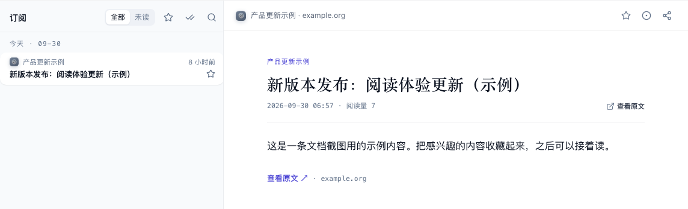

# 看版本更新

产品更新日志、版本发布说明这类短条目，和文章放在同一个「文章」列表里，带一枚「版本更新」小签，用紧凑的单行显示。想知道你关注的工具最近改了什么，可以只看这一类，扫一遍标题再打开感兴趣的那条。

## 怎么用

### 只看版本更新

点左侧竖栏的「文章」。列表标题下面有一排类型：「全部类型」「论文」「教程」「观点」「版本更新」等，点「版本更新」就只剩更新日志和发布说明；再点一次回到全部。只会列出当前范围里有内容的类型。

点来源栏里的一个来源（例如某个工具的 Changelog），只看它的更新；在列表里点一条，右侧打开正文。需要完整说明时，点「查看原文」。

想增加来源，去[发现](/features/discover)预览并订阅。发现页的来源卡片上标着「版本更新」的，就是这类来源。

### 留下想再看的条目

版本更新同样可以筛选未读、搜索和收藏，操作与[文章里的未读、标读与收藏](/features/reader#未读、标读与收藏)相同。按类型筛选时，列表头的「全部标为已读」会暂时收起，因为它会连同没显示的其它类型一起标掉。

### 看懂列表和正文

版本更新以来源、发布时间和标题为主，不逐条铺开摘要，适合先扫一遍。点开后查看完整说明，正文中的版本号、链接和配图以来源提供的内容为准。是否有 AI 速读、评分或翻译，取决于这一条已提供的内容和你账号可用的功能，不是每条都有。

右键条目可收藏、标读、复制站内链接或打开原文，详见[文章右键菜单](/features/reader#右键菜单)。

## 常见问题

### 以前的「动态」去哪了？

「动态」已经并入「文章」。更新日志和发布说明现在按内容类型标成「版本更新」，在文章列表里用紧凑行显示，用列表上方的类型筛选就能单独看。

### 没看到想看的更新？

先确认已经在[发现](/features/discover)订阅对应来源，再检查是否选中了单个来源，或开启了未读、收藏、搜索、类型筛选。
