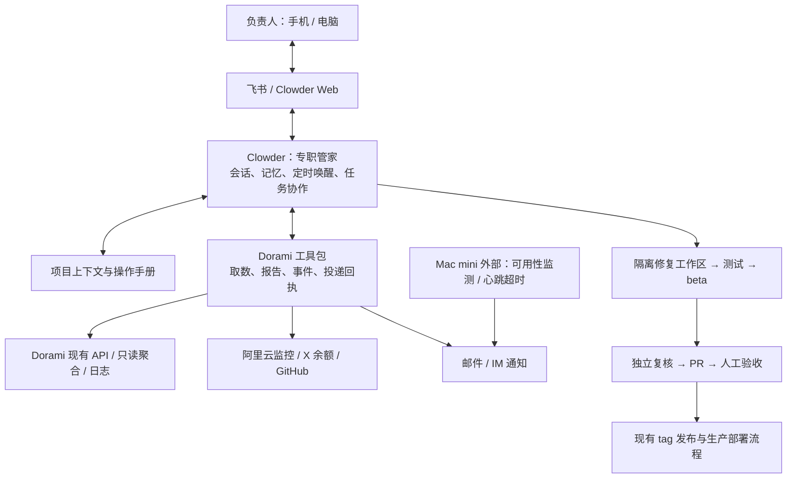

# Dorami 智能管家方案：Clowder AI

> 状态:排队中(R1 设计稿已出、未部署;原状态见下)

> 关联：[issue #132](https://github.com/zlzfun/DoramiSourceArchive/issues/132)。
> 2026-09-24，R1 设计稿。**用户已确定采用 Clowder AI**；本文给出建议的装配、部署与验收方案，尚未部署。
> 核心约束：管家的接入与日常运行不修改 Dorami 后端；ECS、X 等外部指标由管家直接接入。
> 代码核对基线：Dorami `7e2da965e1b1119675e588235ceb48cf3de3b889`；Clowder `5968c19ad8b334ba8497fbb722b3e908b0e135e1`。
> Clowder 基线是此前获取的 2026-09-21 提交，不宣称为当前最新版本；实施时选择经过验收的固定版本。

## 1. 交付形态与已确定的边界

在长期运行的 Mac mini 上部署 Clowder，配置一个专职「哆啦美管家」。负责人通过聊天渠道或 Clowder 网页联系它；它掌握项目、生产拓扑、指标定义和操作手册，按时汇报、处理异常、整理反馈，并把适合自动修复的问题推进到 PR 与 beta 验收。

主体工作是装配 agent：项目上下文、Clowder 配置、已有工具、少量采集与投递脚本、可验证的操作流程。首期交付中不包含新管理后台或通用工作流引擎。

| 范围 | 方案 |
|---|---|
| agent 宿主 | Clowder AI，持久化模式，固定版本运行 |
| 首期智能体 | 一名主管家；修复和独立复核按需启动，不持续多 agent 讨论 |
| 数据获取 | Dorami 现有 API / 日志 / 只读聚合；阿里云和 X 的官方接口 |
| 交互入口 | 暂按飞书私聊为主、Clowder Web 为电脑工作台；渠道偏好可替换 |
| 报告与通知 | IM 摘要 + 邮件完整报告；关键告警有独立通知兜底；短信后续按实际需要配置 |
| 自主处理范围 | 观察、解释、报告、归并 issue、已授权的小修复、测试、beta 部署、PR |
| 生产变更 | 保留现有人工验收、交叉检视、合入、tag 发布及部署门禁；首期不自动改生产 |
| 与 #82 的关系 | 不等待节点看护落地；其结构化事件可用后接入，逐项替换临时判定 |

下面的渠道、时间、频率、预算和阈值是 R1 默认建议，不代表已在真实账号上配置或获得生产写入授权。

## 2. 总体结构与职责



| 组件 | 负责什么 | 本次需要补什么 |
|---|---|---|
| Clowder | agent 调用、会话、共享记忆、渠道绑定、定时唤醒、代码协作 | 配置角色、工具、项目上下文和任务；核验实际调用与渠道行为 |
| Dorami 工具包 | 可复算的数据、确定性阈值、报告文件、通知记录、有限动作 | 少量 CLI/脚本和 skill；必要时提供薄 MCP 封装 |
| Mac mini 守护 | 常驻进程、重启、轻量采集、报告超时补发、投递重试 | launchd 托管配置与一个有锁的巡检入口 |
| 独立监测 | 发现生产入口故障、Mac mini 心跳缺失 | 复用云监控并接入外部心跳服务；通知不经过 Mac mini |
| Dorami beta | 验证具体提交的修复效果 | 独立配置、测试数据、端口、资源限额和部署回执 |

**数字与阈值由程序确定，agent 负责解释、诊断、选择下一步和编写修复。** 正常巡检不逐次调用模型；出现新异常、需要解释、有人提问或到日报时间时才唤醒。

工具包首期是命令行程序与配置集合，不开新的公网服务。只有 Clowder 既有接口确实不够时，才增加局部适配，记录对应上游版本与测试。

### 2.1 对 Clowder 的复用依据

- 已核对源码中的定时任务、SQLite 运行记录、IM connector、共享记忆与 GitHub 跟踪实现；总体平台职责见 [Clowder 官方说明](https://github.com/zts212653/clowder-ai#what-it-does)。这些能力仍需在本机组合验收。
- `reminder` 模板会记录触发消息再唤醒 agent，但唤醒调用采用 best-effort，调度成功不能证明 agent 已完成或邮件已发送。见[核对版本源码](https://github.com/zts212653/clowder-ai/blob/5968c19ad8b334ba8497fbb722b3e908b0e135e1/packages/api/src/infrastructure/scheduler/templates/reminder.ts)。因此业务完成状态放在工具包的明确回执中。
- 已有飞书、Telegram 等 connector；首期先验证一个渠道的接收、回复、重连、重复消息和身份绑定。后续渠道只新增适配和身份映射。
- SMTP 实现位于 Signal Hunter 日报模块，不能直接视为通用运维邮件工具；优先复用可抽离的发送能力，否则提供小型 SMTP 适配。见[邮件服务源码](https://github.com/zts212653/clowder-ai/blob/5968c19ad8b334ba8497fbb722b3e908b0e135e1/packages/api/src/domains/signals/services/email-service.ts)。
- 固定版本使用经核验的 `start:direct` 路径；不用会自动跟随上游的启动方式。持久化运行不用 `--memory`，见[上游启动说明](https://github.com/zts212653/clowder-ai/blob/5968c19ad8b334ba8497fbb722b3e908b0e135e1/docs/configuration/startup.zh-CN.md)。依赖版本以所选提交的 package/lock 文件为准。

### 2.2 工具包与 Clowder 的最小接口

以下是拟实现的工具职责，不是 Clowder 已自带的 Dorami 命令。首期先做 CLI，skill 调用同一实现；多个调用方需要结构化接入时再提供 MCP：

| 工具职责 | 输入 | 返回证据 |
|---|---|---|
| `collect_snapshot` | 环境 ID、时间窗、指标集 | 快照 ID、来源时间、完整性、统计值 |
| `render_report` | 快照 ID、可选智能摘要 | 报告 ID、文件、校验值、降级状态 |
| `notify_report` | 报告/事件 ID、已登记收件目标 | 各渠道尝试与供应商回执 |
| `triage_incident` | 事件或反馈 ID | 归并结果、证据引用、关联 issue |
| `request_repair` | issue、范围、验收、预算 | Clowder 任务引用、工作区、当前状态 |
| `run_action` | 白名单动作 ID、环境、结构化参数 | 授权核验、实际动作、独立复查结果 |

所有调用带稳定请求 ID；重复请求返回既有结果或当前状态。工具拒绝未经登记的收件地址、生产写入目标和任意 shell 参数。

采集器发现新事件后，由 `clowder_bridge` 适配固定版本的消息入口。已核对 `POST /api/messages` 存在 `threadId`、`idempotencyKey` 与异步 invocation 流程；实现需验证严格身份、目标角色路由、受理返回值和终态读取，不能把 HTTP 202 当作任务完成。桥接只走受保护的本机入口，不把身份头当作公网认证。见[消息路由源码](https://github.com/zts212653/clowder-ai/blob/5968c19ad8b334ba8497fbb722b3e908b0e135e1/packages/api/src/routes/messages.ts)。

P0 必须做通“注入一条事件 → 唤醒正确角色 → 产生工具回执 → 回传绑定渠道”。若固定版本不能通过现有入口可靠完成，先提交最小桥接适配；未完成前保留直接报警，不宣称自动诊断就绪。

## 3. 智能体、上下文与记忆

### 3.1 角色配置

| 角色 | 默认职责 | 启动方式 |
|---|---|---|
| `dorami-butler` | 日常对话、解释报告、异常分诊、反馈归并、修复协调 | Clowder 常驻角色，按消息/定时/事件唤醒 |
| `dorami-fixer` | 复现、改代码、测试、部署隔离 beta、准备 PR | 按需任务，首期最多一个修复任务运行 |
| `dorami-reviewer` | 以证据复核代码与验收；不能由同一实现者自审 | 修复完成后按需启动，遵循仓库跨模型检视约定 |

建议主管家与修复角色先使用 Claude Code，Codex 承担独立复核；这是角色分配默认值，具体模型与账号取决于 Mac mini 已有可用授权，实施时固定记录。更换底层 CLI 不改变指标定义、事件记录和工具协议。

### 3.2 上下文包

管家工作区维护以下小型文档，每份标明负责人、更新时间与适用环境：

- `project.md`：Dorami 的业务、架构、仓库、文档入口，指向现有 `AGENTS.md` / `CLAUDE.md`，不复制一套长期漂移的开发规范。
- `environments.yaml`：生产外网/内网、beta 的逻辑 ID、用途、入口、时区、版本与网络可达性；秘密仅引用凭据名称。
- `metrics.yaml`：指标公式、数据源、覆盖范围、时间语义、精度、允许的陈旧时间。
- `policy.yaml`：可读对象、动作白名单、预算、身份映射、通知收件范围和停止开关。
- `runbooks/`：日报、异常调查、反馈归并、beta 修复、自愈流程；包含前置条件、完成证据和失败出口。
- `decisions.md`：经负责人确认的决策。新的自动建议写入候选记录，不自动改变权限或规则。

Clowder 记忆存放经验摘要、诊断线索和上述证据的引用；事实以采集快照、工具回执、GitHub issue/PR 与部署身份为准。一次 agent 的“已完成”回复不能替代这些记录。

## 4. 数据接入与指标口径

### 4.1 接入方式

优先访问现有只读 API；缺少合适聚合时，由受限采集程序执行固定 SQL 或读取一致性快照，再输出脱敏统计。不要导入会初始化/迁移数据库的 Dorami 应用模块来完成只读采集，也不要直接复制仍在写入的 SQLite 主文件而忽略 WAL。

API 使用专用身份，其权限与可用字段必须实测。**目前管理员身份不等于只读身份，普通管理员也不能读取全部用户明细。** 若需要管理员凭据或包含机密的原始数据库，由独立采集身份保管，agent 只取得脱敏结果；不能只靠“请勿写入”的提示词隔离权限。

内外网按环境分别采集。Mac mini 无法访问内网时，通过已有 VPN 或内网侧受限导出取数；未接通时报告标注该环境缺失，不把公网节点的数据当作全站数据。

### 4.2 第一批指标

| 维度 | 首选来源 | 首期定义与限制 |
|---|---|---|
| 现存账户、创建日分布 | `/api/admin/account-growth`、`/api/admin/overview` | 新增写为“昨日创建且采集时仍存在的账户”；现有增长曲线不包含已删除账户，不冒称历史开户总量 |
| 活跃读者、阅读次数 | `reader_reads` 日聚合或满足窗口的现有统计接口 | 活跃读者 = 当日有主动阅读记录的不同读者；阅读次数 = 主动打开文章的记录数，不能替代 PV/UV；删号墓碑与管理员排除策略单独记录 |
| 登录 | 已有登录事件聚合 | 标为登录次数/登录人数，不解释为访问量 |
| HTTP 访问 | 现有 Nginx / 网关 access log | 首期提供“过滤静态资源、健康探针等后的 HTTP 请求量”；SPA 日志不能可靠还原页面 PV、独立访客 UV，无法取得则标不可得 |
| 采集运行 | `/api/fetch-runs`，按环境 + run ID 去重 | 统计节点运行成功/失败、抓取产出、存储接受、跳过；父采集任务与子节点运行分别汇总，不能相加 |
| 严格新增文章 | 经过核实的新增事件，或从启用日起记录的文章 ID 首见集合 | 当前 `saved_count` 包含部分已有文章补正文/更新；不可直接称严格新增。快照差值只叫“观察到首次出现”，会漏掉两次快照间新增后删除的文章 |
| 节点健康 | `/api/source-health`、`/api/source-states` | 分别显示 healthy/failing/running/never_run/unknown；这是执行状态，产出质量与静默另列，不以一次零新增判故障 |
| 任务、同步、分析、备份 | 现有 jobs、运行记录、备份回执 | 无收据的任务不能声称完整识别缺席；备份“已生成”与“恢复演练通过”分开 |
| ECS 资源 | 阿里云云监控、ECS 只读接口 | CPU、网络与实例状态；内存/文件系统指标取决于监控插件和实际可用数据，不以缺失表示正常 |
| X 真实余额 | X 官方 `GET /2/usage/credits` | 按账号与币种保存余额和获取时间；验证 PPU 资格、凭据权限与返回形状 |
| X Dorami 消耗估算 | `/api/x-api/quota` | 本地 UTC 月用量与估算费用；与供应商余额分别列出，不能用预算减估算值冒充真实余额 |
| 反馈与修复 | `/api/admin/feedback`、GitHub issue/PR/CI | 新反馈、待处理事件、修复进度、已合入与已发布分别呈现 |

阿里云主机指标与通知接入参考[官方主机监控文档](https://help.aliyun.com/zh/cms/user-guide/monitoring-host)。X 已提供 PPU 余额接口，参考 [Usage](https://docs.x.com/x-api/usage/introduction) 和 [Get usage credits](https://docs.x.com/x-api/usage/get-usage-credits)。本次未访问用户真实云账号或 X 余额。

### 4.3 时间、完整性和历史

- 业务日报默认每天 **09:00，Asia/Shanghai**，统计前一自然日 `[00:00, 次日00:00)`；历史事件在管家侧存 UTC + 原始时区。Mac mini 系统时区不隐式决定统计日。
- Dorami 的部分时间是服务器本地日期/无时区字符串，阅读已按日聚合；先登记每个环境时区再映射，不能把已经聚合的日计数精确重分到另一时区。X 月度预算保留 UTC 月口径。
- 节点运行按开始时间归属统计日，尚未完成的单列；迟到终态产生修订版。只取 `days=1` 在次日上午通常会取到“今天”，必须抓取覆盖目标日的数据后显式过滤。
- API 翻页以 ID 去重，检测上限、截断和分页期间新增；精确日报优先固定时间窗的一致性聚合。单页上限不意味着全量。
- 内外网文章可能经 Archive Sync 复制：采集产出归采集节点，读者使用归服务节点；跨环境账户未映射前不简单相加为“全站人数”。
- 每个指标携带 `window`、`source`、`observed_at`、`quality`（完整/部分/缺失/估算/陈旧）与口径版本。缺失用 `null` 和原因，不能补零。
- 报告保存当时的不可变快照；补数形成明确修订版。七日对比只使用同口径完整样本，没有基线时省略百分比。

## 5. 日报、巡检与投递流程

### 5.1 每日报告

默认时间流程：

1. **08:50**：Clowder 唤醒管家，工具采集昨日快照并生成确定性的数字表；采集不完整时保留缺失原因。
2. 管家在快照基础上写摘要：整体状态、显著变化、需要处理的异常、昨日动作及今天建议。每项判断指向证据。
3. **09:00 前**：工具固化 Markdown/HTML 与报告 ID，邮件发送完整报告，IM 发送摘要和可访问的详情入口。
4. **09:05 截止**：独立轻量脚本检查回执；模型不可用或超时则发送程序生成的基础报告，明确“智能分析未完成”。已发送的渠道不重复发送。
5. 恢复后可补充诊断；不会静默覆盖已发送报告或自动反复发同一份全文。

报告固定包含：统计时间/数据覆盖 → 需处理事项 → 用户与使用 → 采集与任务 → 节点与基础设施 → 余额与预算 → 反馈/issue/PR → 数据缺口。详情仅放在负责人可访问位置，IM 不出现只能在 Mac mini 本地打开的路径。

### 5.2 调度分工

| 工作 | 默认频率 | 执行者 |
|---|---|---|
| 日报解释与编排 | 每日 08:50 | Clowder scheduler + 主管家 |
| 云资源、服务状态、采集异常、反馈增量 | 每 5 分钟 | 一个轻量采集入口；有新事件才唤醒管家 |
| X 余额 | 每小时 | 只读采集器；低余额时可缩短到 15 分钟，遵守 API 限流 |
| 报告截止检查、通知重试、失联心跳 | 每分钟 | launchd 调用有锁的轻量脚本，不调用模型 |
| 对外服务可用性 | 每分钟 | 云侧独立探针；不依赖 Mac mini |
| 问答、修复 | 按消息/事件 | Clowder 路由到对应任务 |

只有 Clowder 负责智能任务调度。launchd 脚本只负责确定性采集和兜底，各工作用独立键去重，不另外实现通用调度平台。模型未能被唤醒时，严重告警与基础日报仍有直接邮件路径。

### 5.3 完成与投递回执

工具包用一个本地 SQLite 小账本记录快照索引、事件、操作和待投递消息，避免依赖聊天文本判断状态；Clowder 自身的会话/调度数据仍由 Clowder 维护，不读写其内部表。

- 报告唯一键：`环境集合 + 业务日 + 口径版本 + 修订号`；事件键：`环境 + 对象 + 规则 + 故障轮次`。
- 报告状态：`due → collecting → ready/degraded → notification_pending → submitted/failed/unknown`。每个渠道分别记录；IM 成功不掩盖邮件失败。
- 保存 `run_id`、Clowder 任务引用、产物校验值、尝试时间、供应商消息 ID、失败原因；写入待投递项和业务状态使用同一事务。
- SMTP 接受表示交给邮件服务器；IM 返回消息 ID 表示平台接受。除非有对应回执，不声称用户已收到/阅读。
- 默认失败退避 1、5、15 分钟，之后告警待处理。请求超时而发送结果不明时记 `unknown`；支持查询或幂等键的渠道先核对，SMTP 不能保证恰好一次。
- 重启时检查未完成记录；租约过期任务可重入，先核对已有产物和远端副作用。显式补发生成新的发送尝试，并保留原报告 ID。

## 6. 异常判断与主动反馈

先落地阈值明确的规则，再增加 agent 对日志、趋势和关联事件的诊断。模型推断作为“疑似原因”展示，不直接成为恢复判据。

| 事件 | R1 默认判定 | 通知方式 |
|---|---|---|
| 生产入口不可用 | 每分钟探测，连续 3 次失败；恢复需连续 2 次成功 | 严重：独立邮件/已配置短信立即通知，IM 补充诊断 |
| ECS CPU 持续偏高 | >85% 持续 15 分钟 | 关注；结合延迟与失败率评估影响 |
| 文件系统空间不足 | 使用率 >85% 提醒，>95% 严重；按真实磁盘另校准剩余空间条件 | 同一对象合并提醒 |
| 节点连续失败 | 连续 3 次失败；never_run、停用源和运行中分别处理 | 关注；持续或扩大影响才升级 |
| 节点长期无产出 | 按源自身节奏和完整历史判断；无可靠基线只列观察 | 不因“今天零新增”直接告警 |
| X 即将不足 | 真实余额低于配置阈值，或有效消耗基线估计不足 7 天；不足 2 天升级 | 展示余额时间与估算依据；无基线仅显示余额 |
| 管家失联 | 外部服务连续 5 分钟未收到有效心跳 | 外部服务直接通知负责人 |

费用预测须区分充值、免费额度到期、跨应用消费和消耗；只对覆盖充分的同账号数据计算可用天数。阈值按账号配置，首期不自动充值。

事件经历 `open → acknowledged → resolved`；静默是带到期时间的通知属性，不是恢复。同一故障默认不刷屏；首次、严重度上升、关键诊断变化、恢复时通知，持续未恢复默认最多每 6 小时提醒一次。规则版本和静默到期均留痕。

通知示例形状：**对象 / 环境 / 开始时间 / 影响 / 证据 / 已采取动作 / 下一步 / 事件 ID**。云侧原生报警作为原始紧急通知，管家的后续消息标为该事件的诊断更新，避免两套严重度互相冲突。

## 7. 反馈、issue、自愈与代码迭代

### 7.1 反馈和异常转 issue

每 5 分钟读取站内反馈增量及授权渠道的新反馈，保留来源 ID。先关联已有事件/issue；重复反馈追加到同一记录。发布到 GitHub 前脱敏，私人原文保留在受限证据目录。

自动建 issue 的默认门槛：重复出现且证据清楚的缺陷，或负责人明确提出的需求。单次模糊反馈先形成待澄清项；普通读者的建议不自动升级为已批准开发任务。自动新建 issue 默认每日最多 3 个，超出合并为待分诊清单。

issue 包含现象、环境与版本、复现/证据、期望行为、已排除项、影响、验收条件；事实与根因推测分开。使用稳定事件标记核对创建结果，超时后先搜索对应标记，避免重试生成重复 issue。

### 7.2 自愈权限

| 操作 | 首期策略 |
|---|---|
| 重新取数、重算报告、重试投递 | 工具按幂等键和次数限制自动完成 |
| 记录/归并 issue，执行已授权修复任务 | 按本方案策略推进，保留审计记录 |
| 重启失败的 beta 进程、重跑无外部收费的 beta 任务 | 验证对应 runbook 后加入白名单；每事件最多 1 次 |
| 生产任务补跑、节点开关、服务重启 | 首期只诊断与提出具体操作；后续逐动作授权，不能继承 beta 权限 |
| 生产部署/回滚、DB 恢复、权限与凭据修改、充值 | 走现有人工操作与审批流程 |
| 管家修改自身运行配置或自动升级 Clowder | 运维维护任务，保留人工维护入口，不由值班 agent 自行变更 |

每个白名单动作写明对象、前置条件、允许参数、预算、超时、验证方式、失败出口。恢复要求独立复查业务状态；停止开关关闭新的写操作，已在途动作检查取消点，读取与报警继续工作。

### 7.3 简单缺陷修复流程

1. **准入**：有明确现象和验收条件；文案、局部解析/样式、小范围逻辑缺陷可入队。数据库迁移、认证/权限、计费、发布链路和大范围结构变化进入人工设计。
2. **任务化**：从当前仓库基线建立独立 worktree，记录 issue、基线 SHA、负责人授权范围；不复用日常管家工作区或用户脏工作区。
3. **复现与修改**：先保存失败证据，再修改；新功能只能来自负责人确认的需求。遵循本仓工程约定。
4. **验证**：相关测试、必要的前端构建/交互检查、隔离 beta 部署；记录实际 SHA、数据集、配置版本、结果和截图。模型自述不算验证。
5. **独立复核与 PR**：实现者与复核者不同，优先跨模型；按 `CLAUDE.md` 逐条协商并收口意见，保留检视记录。
6. **交付**：回传 PR、beta 地址、验证证据与剩余风险，状态到“待负责人验收”。合入与 tag 发布仍沿用现有流程。
7. **发布跟踪**：区分已修复、已合入、已发布、生产验证通过；只有目标环境版本与复查结果都吻合才关闭故障。

R1 默认修复并发 1，单任务最多 2 轮修复、90 分钟主动执行时间；达到次数、时长或配置的模型费用/调用额度上限即保留成果并上报。复核发现阻断问题时不得靠继续增加 agent 绕过限制。

## 8. 多渠道交互与任务组织

首期一个私人 IM 会话处理查询与通知；Clowder Web 查看证据和复杂任务。报告按日期、异常按事件、修复按 issue 分任务；保持一个总览入口，避免全部内容累积在永久超长上下文。

自然语言对应有界操作，例如：

| 用户表达 | 管家的处理 |
|---|---|
| “昨天运行怎么样？” | 读取已保存报告，说明窗口和缺失数据；需要时刷新 |
| “为什么抓取少了？” | 对比同口径运行、任务计划、失败源和产出，给出证据与假设 |
| “X 还能用多久？” | 读取真实余额、历史用量；有基线才估算天数 |
| “把这个故障处理掉” | 查事件和授权范围，能自动修复则受理并返回任务 ID |
| “暂停自动修复” | 停止接收新修复/写动作，报告正在运行的任务及可停止状态 |
| “这个告警今晚不再提醒” | 绑定具体事件和到期时间，静默通知但继续观察 |

渠道用户 ID 映射到唯一负责人身份；第二渠道通过既有可信入口绑定，不能按昵称匹配。只向明确绑定且授权的会话发送敏感运行信息；新群聊不自动继承私人会话权限。

跨渠道的操作确认绑定 **动作 ID、目标环境、参数/提交 SHA、有效期、确认人**，消费一次后失效，避免旧“同意”被用于新操作。长任务先返回受理回执，随后只报告有意义的进展与最终结果。

站内用户反馈、抓取正文、日志和 issue 内容都是待分析资料，不能覆盖管家权限、指挥 shell 或指示外发秘密。所有写动作经同一权限检查，渠道数量不扩大权限。

## 9. Mac mini 与 beta 部署

### 9.1 运行布局

以下为建议布局，不代表已存在的目录：

```text
独立 Clowder 安装目录/    固定版本代码与运行配置
dorami-butler/           独立配置与工具包仓库
  context/              项目、指标、环境说明
  skills/               值班与修复操作手册
  tools/                采集、报告、投递、beta 操作
  policies/             身份、阈值、预算、动作白名单
  fixtures/             脱敏样本与验收数据
受限运行数据目录/       Clowder 状态、管家账本、报告与证据
dorami-beta/            固定 beta 部署与独立数据
dorami-worktrees/       按修复任务创建的临时 checkout
```

本仓保留产品方案和索引；后续运行工具与秘密配置在独立的 `dorami-butler` 工作区维护。Clowder 上游代码、运行数据、Dorami 源码和 beta 数据各有独立生命周期。

### 9.2 常驻与资源

- Clowder 使用宿主机安装，以便复用 agent CLI；Redis 开持久化，SQLite/附件/调度等实际数据路径从所选版本配置盘点，统一备份。
- launchd 托管固定版本入口、轻量脚本及独立采集身份；显式配置工作目录、PATH、日志轮转、退避重启，避免桌面应用开着才可值班。
- 无人值守验收必须覆盖重启、注销、CLI 凭据续期、钥匙串访问、网络恢复。FileVault 启动解锁若需要人工，不声称断电后可完全无人值守恢复，也不默认关闭加密。
- beta 推荐独立 Docker Compose 项目，数据/配置/网络/端口分离，单个任务取得部署租约后才能占用共享 beta。ARM Mac 的镜像与所需依赖先做构建验证；Linux/ECS 特有问题仍需 CI 或对应平台验证。
- 配置 CPU/内存上限，优先保障值班和通知；构建或模型任务超限时降并发，不让 beta 压力使管家失联。具体上限依据 Mac mini 实际内存与负载确定。

### 9.3 数据、凭据与可达性

- beta 使用合成或脱敏数据，清除生产账号密码、令牌、收费服务凭据和生产写入目标；付费调用与定时抓取默认关闭。只有特定验收需要时开启限额测试凭据。
- 生产采集身份与编码 agent 分离；凭据由采集/投递执行身份保管。代码 agent 无权读取该身份的秘密目录或修改其执行体；MCP 包装本身不构成权限隔离。
- beta 管理只针对预登记项目和环境，禁止传入任意主机/任意 shell。GitHub token 限定目标仓库所需 issue/PR 权限，不带生产发布凭据。
- 首期优先出站连接：IM 长连接/轮询、HTTPS API、GitHub 轮询；不为接收消息暴露 Mac mini 公网端口。Web 和 beta 通过已有受控局域网/VPN 访问，实际网络方案在安装时确认。
- 外部监测托管在 Mac mini 之外。心跳携带采集新鲜度和通知能力状态；单纯进程存活不能掩盖“采集停了、邮件发不出”。外部服务独立报警联系人与通道必须实发验证。

### 9.4 升级、备份与恢复

Clowder 和工具包按固定提交升级；先备份并在复制状态上验证迁移、定时任务、渠道和 agent 调用，再切换。升级失败按该版本支持方式恢复整套状态；不能假设旧代码能直接打开迁移后的数据库。

每日备份 Clowder 持久状态、管家账本和配置至 Mac mini 外部的受限存储，运行秘密单独按凭据管理方式备份。R1 建议报告/结构化记录保留 90 天、脱敏原始证据 14 天、备份 7 个日版本；按空间与实际需求调整。重建 Mac mini 后需验证恢复的身份绑定、投递去重与任务状态。

## 10. 实施拆分与验收

各阶段是工作包，实施时再拆子 issue；本次只落设计，不批量创建空任务。

| 阶段 | 交付 | 验收出口 |
|---|---|---|
| P0：宿主与接入验证 | 固定版本 Clowder、一个主角色、IM、持久化、上下文、网络和身份清单 | 手机发起查询、电脑查看同一任务；重启后会话/绑定保留；外部能识别 Mac mini 失联 |
| P1：日报与告警 | Dorami/云/X 采集、指标契约、报告、邮件、事件与投递账本、独立监测 | 连续 7 天形成可核对日报；模型故障仍出基础报；故障注入验证告警与恢复 |
| P2：反馈与低风险自愈 | 反馈归并、自动 issue、停止开关、一个 beta 自愈 runbook | 重复事件只对应一个 issue；自愈能复验，失败后停止而非无限重试 |
| P3：修复闭环 | 独立 worktree、测试、beta、跨模型复核、PR 与发布跟踪 | 一个真实小 bug 从复现到 PR/beta 证据完整；负责人验收后进入既有发布流程 |
| P4：扩展 | 第二聊天渠道、短信、更多数据源及逐项生产白名单 | 跨渠道身份/任务一致；每项新权限有对应故障与恢复验证 |

**首个可用版本 = P0 + P1。** 它已能每天汇报、主动报警并接受追问；之后在这个真实运行的管家上逐步增加处理权限。

必须覆盖的验收场景：

1. **指标一致性**：选定一天与原始数据核对；覆盖跨日、翻页、删除账户、重复采集、文章更新、内外网复制与缺失数据，数字不可由模型补齐。
2. **定时与降级**：正常日报、agent 限流/失效、取数失败、重启错过时间、迟到补数，均有明确产物与状态。
3. **投递**：邮件/IM 成功、单通道失败、发送结果不明、重启后重试；验证不把触发成功等同投递成功，不承诺 SMTP 恰好一次。
4. **告警**：生产探针故障测试目标约 3–5 分钟通知；Mac mini 心跳缺失目标约 5–7 分钟通知；采集规则在两轮内发现。上述为待验收目标，含依赖服务延迟。
5. **自愈**：beta 故障一次恢复、恢复失败、重复消息、取消动作；不触及生产环境。
6. **代码修复**：证据复现、准确提交、测试、beta 身份、独立复核、PR、用户验收；敏感模块不自动放行。
7. **权限与恢复**：陌生身份/旧确认/日志指令不能触发写操作；断网、CLI 登录失效、进程崩溃与宿主重启可被发现；恢复不会重复建 issue 或把未完成工作宣告成功。

## 11. 实施前需要补齐的信息

以下影响配置与真实接入，不阻碍按本文准备工具和样本：

| 信息 | R1 暂定 / 获取方式 |
|---|---|
| 首个聊天渠道 | 暂按飞书；换为 Telegram/企业微信只调整 connector 与接入验收 |
| 日报时间、时区、收件人 | 09:00 Asia/Shanghai；收件范围由负责人指定，不推断地址 |
| Mac mini 规格与实际主机 | 安装时确认内存、系统、可用空间及当前 CLI；不假定当前开发机就是目标 Mac mini |
| 生产节点、网络与数据权限 | 对照真实环境清单确认外网/内网地址、时区、监控插件、取数方式和最小凭据 |
| X 账号与额度 | 验证 PPU 余额接口权限；不可用时保留本地估算并明确余额不可得 |
| 邮件与独立失联监测 | 选择已有可用 SMTP 和外部心跳服务；真实发送与断网演练后才声明就绪 |
| 模型与付费预算 | 沿用可用账号，确认无人值守可调用性；配置硬限额，价格与实际可观测费用在安装时核定 |
| 生产自动动作 | 初始白名单为空；beta 先验证，后续逐项授权 |

## 12. 设计核对记录

本稿核对了 Dorami 的管理统计、阅读计量、采集管线/存储返回语义、节点健康、X quota、备份与发布约定，以及固定版本 Clowder 的 reminder、启动和渠道相关能力；另查证 X 官方余额接口。

已据此处理的设计风险：

- `saved_count` 会因旧文章更新增加，不能直接统计严格新增。
- 账户增长接口重算现存账户分布，不能恢复全部历史开户。
- `overview.accounts.active` 是账户启用状态，不能充当活跃用户。
- Clowder scheduler 的成功回执不能替代 agent 完成和外部投递回执。
- 原生 SMTP 模块有业务上下文，通用报告发送仍需适配。
- Mac mini 内部的 watchdog 不能发现整机断电，必须有外部失联通知。

本次仅做设计与代码/文档核对，未运行 Clowder，未连接生产、发送真实通知或部署 beta；运行可靠性按第 10 节实测验收。
