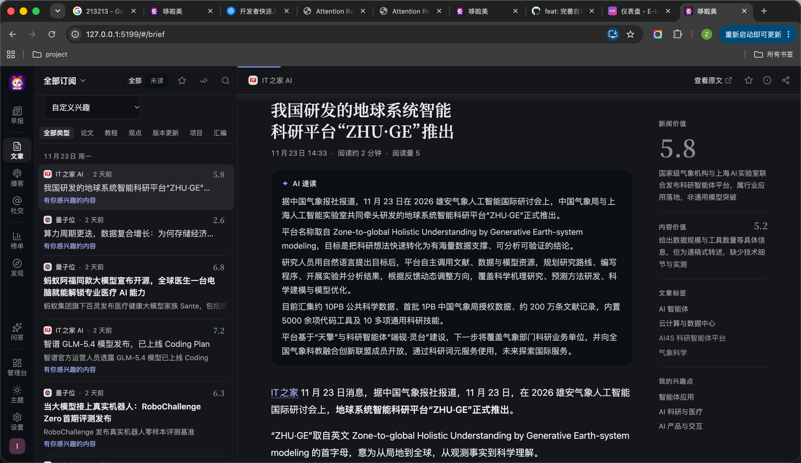

# #298 候选治理、自定义兴趣与新概念审核通知

> 状态:进行中
> 2026-11-17；设计基线 `748248999067dbf085221fe178413b8c0d6e1d7a`。本文件记录方案和验收协议，不表示功能已经实现、部署或完成观察。
> Issue: https://github.com/zlzfun/DoramiSourceArchive/issues/298

## 1. 目标、授权与当前进度

**当前口径（2026-11-24）**：用户已取消持续验证与定时任务，当前使用持久存量副本和真实 admin 验收。累计功能进入提交整理；个人早报改为“新闻价值基础名单＋最多 30% 额外兴趣推荐”，最新规则和测试边界见 §9.11。下文各旧时间点是历史记录，不表示任务仍运行、当前付费许可或已通过语义质量验收。

形成两个完整闭环：

1. 内容分析 → 候选证据净化 → 确定性归并 → 语义分组/新概念提案 → 通知负责人 → 推荐归类 → 审核处理 → 有界补标及受控目录发布。
2. 用户填写兴趣 → 复用正式目录或保存个人条件 → 匹配近期和新增内容 → 下一次个人早报采用 → 推荐原因可追溯。

用户要求完成后使用真实来源及 ASR/TTS 做 2–3 天自动观察，最终在原聊天交付报告；本次验证 TTS 每日不超过 ¥20，允许扩大实验源覆盖。2026-11-17 补充要求：新公共概念必须主动通知负责人，给出推荐归类以便处理。本次明确扩大原 issue 的“无新增通知渠道”范围，用户随后选定飞书机器人，每天北京时间 18:00；无新增或重要变化不发送。

当前已完成 P0–P3、飞书签名机器人接通、三集真实 ASR 和六篇文章 TTS、停费重放及真实 UI 验收，公共订阅已从 31 扩至 34 源。显式语义说明已通过后端全量 4205 项（1 跳过）、前端 412 项与限定复检；25 条实验条件已正常保存。238 对 v3 真实验证得到 7 TP/2 FP、core precision 77.8%，未达到 90% 门槛，62 对最终 unknown；旧参考、评分和 444 条请求保留。

用户选择的 Pro/high/8192 阶段已在 32 篇新正文、224 对冻结参考上执行 23 次 POST，因 10 次 HTTP 读取超时和 1 次外层取消而自动停费；12 次成功请求含 7 no_match、5 模型 unknown。完整参考池仅 9 对有效终态（含 2 个字面排除），23 个参考 core 均未获证实，质量门未通过，不能据此判断 Pro 效果优劣。累计 467 条请求完整保留。停费后的兴趣专用路由通过 369 项受影响测试与限定复检，实际 runtime 尚未对齐；34 源的源级分析开关已正常 API 补齐，但全局分析/付费/调度保持关闭。用户已明确选择“修正等待设置，继续 Pro 验证”：同意独立最长 6 小时、只处理未发送 199 对，旧 23 对禁重跑，原 467 行完整保护，预算仍从 444 起累计 400 次（已用 23、余 377）。新运行器 56 项离线测试及 10 项子测试通过；隔离只读 UI 和限定复检进行中，实际新阶段尚未 prepare/run。正式 72h 和每日审核清单均未启动，不改生产配置。

| 选择 | 建议 | 状态 |
| --- | --- | --- |
| 验证环境 | 独立验收环境，真实公共源、真实模型及语音 | 作为当前执行默认；不据此授权生产灰度 |
| 公共治理 | 名称/唯一已有别名精确归并自动执行；近义/新概念形成提案，通知后审核 | 用户补充了审核通知需求；不据此开放自动晋升 |
| 通知渠道 | Dorami 内待审核列表 + 飞书自定义群机器人 | 审核群与签名密钥已配置，单次连接测试已接收；正式清单尚未启用 |
| 通知节奏 | 每天 18:00，Asia/Shanghai，汇总新增/有实质更新的概念组，无变化不发 | 用户已确认 |
| 早报名额 | 保持现有新闻/深读/播客名额与质量门槛 | 推荐默认，不借实验扩版 |
| 低频候选 | 近期每日复查；30 天无独立支持后每周复查，新独立证据唤醒 | 初始参数，时间推进测试及真实分布校准 |

## 2. 当前代码事实与设计约束

- `taxonomy.run_auto_activation_cycle` 固定取最老 100 条；实体取出后跳过；单条失败会影响整轮。
- `article_analysis._refresh_candidate_stats` 与 `taxonomy.aggregate_candidate` 的窗口、未来日期、均值口径不一致；无新增证据时不会自然刷新。
- 实时候选写入未统一使用全库正式名称/别名解析；`nearest_similarity=None` 会通过自动晋升检查。
- 现有 `retag_article_from_evidence` 把候选 confidence 直接写成 relevance；必须分离“身份相同”与“文章核心相关”。
- 正式兴趣目录仅为热度 Top N；前端只过滤已加载目录。早报兴趣版本只有正式标签行，custom-only 会在多处被判断为空，生成提交也缺少偏好修订围栏。
- TTS 现有月度/单次限额，没有每日人民币硬限额。旧工作区语音配置的授权/路径已过期，不能原样起服。
- 最新 #263 已取消整机 consumer 角色；内容可以逐行本机更新和链式转发。Taxonomy 的治理权限仍由专属部署模式及 `taxonomy:authority_id` 控制，不得恢复旧全机围栏。同步 authority ID 是上一跳身份，不能充当独立原始来源计数。
- 当前没有可直接复用的邮件/IM 可靠投递服务。公告广播、进程内更新事件、`jobs.launch` 均不等同于持久通知队列；旧代码地图提到的 webhook 文件已不存在。

主要入口：`src/services/{taxonomy,article_analysis,personal_digest,digest_selection,reader_interests,bailian_tts}.py`、`src/api/routers/{taxonomy,interests}.py`、`src/models/db.py`。前端复用 `InterestPage`、`DiscoverPage`、桌面和移动装配；遵守现有无冗余说明文字规范。

## 3. A：候选治理基础

### 3.1 调度与证据

新增 node-local `candidate_governance_state`，记录 candidate、lane、证据修订、最近/下次评估时间、统计时点、规则版本、lease、失败次数与错误码。按到期时间有界领取，新增与存量配额交错；实体单独维护，不挤占主题/行业队列。统计和确定性治理从文章分析 worker 中拆出，不依赖 LLM 是否可用。

统一一个不隐式提交事务的证据聚合实现：7/30 天上下界、非法/未来日期处理、30 天均值一致。保留“全部审核证据”和“晋升有效独立支持”两种投影，按文章身份、内容指纹、原始来源/发布方、当前节点事件归属去重；自家日报等派生物不算独立支持。没有事件去重结果时标记未完成，不虚报独立数。远端仅供审核的证据不擅自变成自动晋升支持。

无新增证据也周期刷新；源权限、内容、分析、事件归属变更使缓存失效。低频降频是可恢复调度状态，不新增候选同步枚举、不删除历史证据。

### 3.2 精确归并与补标

统一 `(kind, normalize_label)` 解析正式名、既有别名和替代链。只对唯一 active 精确匹配自动归并；歧义、跨类型及人工拒绝保持待处理。存量先产 preview，apply 再核对证据指纹、taxonomy revision、规则版本。

治理动作、审计事件、补标任务入队在同一事务完成，动作有唯一幂等键。现有内部 commit 的服务需拆分事务边界，不能外套 savepoint 假装原子。

补标限定近 30 天和有界数量，逐文章绑定内容/分析版本。已有人工指派保持；候选 confidence 只作为召回证据，专门核验相关性后才写 relevance。无足够正文或核验失败，只完成概念身份归并，不抬高推荐分。不把 retag-only 隐式改成全量付费重分析。

### 3.3 语义提案

候选对先按类型、词形、证据重叠召回，再判定 equivalent / broader / narrower / related / distinct / needs_identity_review。相似链不能传递闭包成同义组。

提案保存规范名、别名、类型、定义、使用/排除边界、去重证据、与既有概念的关系、输入指纹、模型/prompt 版本和成本。相似检查明确 `unchecked/checked/failed/stale`，缺结果或过期均不视为通过。公共新概念、语义新增别名、实体身份和 user_selectable 资格分开审核。

## 4. B：自定义兴趣

### 4.1 数据及接口

- `user_interest_conditions`：owner、名称/描述、受限条件 AST、schema version、revision、active/paused/deleted。
- `user_interest_state`：每用户单调集合 revision；正式/自定义兴趣实际变更同事务递增，原样保存不递增。
- `interest_article_matches`：owner、条件及 revision、文章、evidence fingerprint、matcher version；core/mention/no_match/unknown、子条件证据、成本引用。
- 持久匹配任务：近期回补与增量 lane、游标、lease、重试时间；写回前 CAS 校验条件、内容/分析/逐字稿版本与当前权限。
- edition 添加兴趣修订及自定义兴趣快照，保留旧正式兴趣字段以兼容旧记录。

全目录搜索 `GET /api/reader/interests/catalog?q=&cursor=` 查询正式名/别名；无 q 保留热度浏览。旧正式兴趣 PUT 只替换正式兴趣，不能删掉自定义条件。增加 preview、custom CRUD、matches 分页接口；owner 来自认证，更新携带 expected_revision。

### 4.2 匹配与选篇

条件使用 `all_of` 概念组、每组 `any_of` 同义项及 exclude，不接受任意 SQL/FTS。“企业内网 Agent”不能退化成企业 OR 内网 OR Agent。模型辅助生成条件时，用户能在编辑/预览中看到与修正组合范围。

首版是权限/7 天时间窗 → 持久 keyset 每页 200 条扫描 → 字面组合核验 → 仅 mention 进入语义复核。冻结开发样本暴露召回不足：9 个在窗参考 core 中只有 1 个词法 core，另 3 个 mention、5 个 no_match；这些是独立 AI 审阅标签，非人工金标。2026-11-17 用户明确选择加强语义召回后再启动观察。

增量方案采用有界近期语义扫描：当前用户可读、允许外发、具备正文/已发布原始逐字稿且未触发全篇排除项的内容，即使零组字面命中也可排队。每轮最多 6 次实际 HTTP，配置/权限允许语义时，未处理项保持 deferred/unknown，不作为已判无关或核心推荐。无显式语义说明的旧条件在语义未配置或未获授权时保留原词法能力；新语义条件只能给出待核验 unknown，字面排除命中可确定为 no_match。AST（含显式 semantic_intent）是条件唯一准则，名称不能暗加类型条件；例如第七项名称中的“播客”不会变成未保存的格式限制。不自动生成同义词计划，不改变用户条件，也未完成 FTS5 召回优化。

每请求最多 6 个确定性证据窗口、21k 字符，首批均匀覆盖并允许最多 2 个通用 AST 锚点，余下窗口持久分页轮转。部分覆盖下的 mention/no_match 不能终结全文；完成字符区间并集覆盖才可作完整否定。core 要求全部组合组有可验证依据，至少一条正文证据；同一连续实质话题可提前命中，但保存实际覆盖比例。引用按本次发送窗口逐字核验并回填位置；受控来源名称/主机名只辅助发布方身份，不替代正文主题，模型不得拼接广告与不同话题为 core。

语义扫描及每次调用独立持久化：HTTP 前原子记录 authorized；崩溃、超时或未知结果对原内容身份不自动重试。付费内容身份包含 owner、条件修订、实际投影与来源身份，不包含分析更新时间；模型/配置变化不触发重新计费，版本升级也不解锁未决请求。请求身份有数据库唯一约束，条件租约逐调用续期/围栏；旧结果只结算，不覆盖新修订。每轮先轮转不同文章，再推进其后续页；明确延期不占用真实判定分母。这里只限制请求数、输入/输出大小与授权期限，不擅自新增用户未要求的 LLM 日金额限额；TTS 每日 ¥20 独立保留。

默认近期回补 7 天；新内容、再分析、ASR/官方逐字稿发布触发增量。指纹覆盖正文、分析/tag、已发布逐字稿、matcher/prompt/schema 版本。早报只消费已完成匹配，不在编排循环发起大量模型调用。

使用明确 `InterestRef(tag|custom)`，不伪造 tag_code。新闻、深读、播客分别沿用原时间窗、价值门槛、事件去重及来源限额；custom-only 进入原 interest-only 路径。匹配结果不写回公共文章分析、不扩大 feed/MCP 订阅交付范围。

普通保存不重编已完成早报；下一次编排冻结集合 revision。生成期间编辑/删除时，旧任务提交 CAS 失败，持久后继任务使用新修订；有界重试，避免连续编辑饿死。快照保存条件版本、推荐原因与证据引用。

权限至少在召回、外发模型、写回、入选和阅读投影复核。“能阅读”不等于“可发外部模型”；复用 external AI source policy。已完成快照在撤权后也必须过滤/隐藏内容，不能由历史摘要泄漏。

## 5. C：新概念通知与审核闭环（用户新增要求）

### 5.1 进入通知的对象

所有新概念进入待审核列表；外部通知按完成归组的概念提案发送，不逐原始字符串刷屏。每天北京时间 18:00 的摘要包含上次已确认接收摘要以来新出现、达到审核条件或有实质证据更新的组；低支持项目归入“继续观察”，不为低频噪声单独弹提醒。分组不应无限等待：超过配置的分组超时仍以“尚未归组”进入列表/摘要，保留可发现性。

优先级由独立原始来源、时间跨度、支持增长、概念稳定性和目录冲突等可核查因素组成；模型置信度不冒充概率。新概念至少保留首次/最近出现时间及全部变体，避免把新增证据误称为新概念。

### 5.2 每张审核卡的内容

| 信息 | 内容 |
| --- | --- |
| 概念 | 建议规范名、同义写法、一句话定义 |
| 证据 | 去重文章数/独立来源数、时间范围、2–3 篇代表内容链接 |
| 推荐处理 | 归并已有标签、作为已有标签的别名、建立新主题/行业、实体待核验、继续观察 |
| 推荐归类 | 现有 topic/industry/entity 类型、目标正式概念及候选关系；上下位建议仅为关系建议，未实现层级不冒充既有功能 |
| 理由与风险 | 为什么相同/不同、容易混淆的概念、反例、尚缺什么证据 |
| 操作 | 登录审核页后批准、改名/改类型、换目标、拆组、暂缓、拒绝 |

例如“递归自我改进 / RSI”可以提出一个规范概念组；“Agent 记忆”与“GPU 内存”即便部分词相似也不应归并。这是说明性例子，不表示当前已生成这些真实提案。

通知只带最低必要的概念摘要及当前收件人可见的公开证据；不外发私有源正文、登录凭据或带权限的签名链接。审核链接只负责定位页面，GET 不改变状态；操作需登录、角色校验与正常写接口。首期不靠邮件回复中的自由文本直接变更公共标签。

### 5.3 持久投递与处理一致性

新增 `review_proposals` / members / revisions、`review_inbox`、`notification_outbox`、`notification_attempts`。提案可审核状态变化与 outbox 同事务落库；唯一键绑定收件人、channel、组 identity、通知类型和有意义的 revision。批次有固定 batch_id，重启从 lease 恢复。

区分 pending/sending/accepted/delivered/failed/unknown；通道只返回“接收”时不能记作用户已读。支持指数退避、最大重试和失败队列。供应商支持幂等键时复用；不支持时明确至少一次投递、少量重复可能，超时未知不无限盲发。通知失败不丢提案；待审核列表永远可查。

已处理组不重复提醒；仅新独立证据、冲突变化或推荐处置变化才生成新版本通知。暂缓支持时间/证据阈值唤醒，拒绝保留理由并抑制相同提案复活。审核动作必须检查 proposal_revision 与 taxonomy revision，过期返回 409 并展示差异。

审核事务写入决定、治理动作及有限补标任务，关闭/更新待处理项，并取消尚未发送的过期通知。已发通知打开后显示当前处理状态。并发审核/重复点击只产生一次动作。批准新概念并不绕过既有受控 taxonomy 目录发布；实现时明确区分“审核通过”“已发布”“补标完成”。

### 5.4 渠道取舍

> 2026-11-24 最新用户决定覆盖本节的实际接入安排：当前不接入飞书、不通知管理员审核，通知仅保留为默认关闭的灰度能力；以下 2026-11-17 选择和接通事实作为历史记录保留。当前部署执行 [运维手册](../ops/taxonomy-governance.md#4-管理员通知灰度关闭)。

2026-11-17 已选飞书自定义群机器人，每天北京时间 18:00。邮件和其它 IM 为未采用的备选，不在本期同时实现。适配遵循[飞书官方自定义机器人指南](https://open.feishu.cn/document/client-docs/bot-v3/add-custom-bot)：签名校验、请求体上限、业务返回码；通道只确认 accepted，不冒充已读。

- **邮件**：适合定期清单、保留归类依据及审核链接；需要明确收件地址和服务端发送配置。连接的个人邮箱工具可用于原型，不等于 Dorami 已有生产发信能力。
- **飞书/企业微信/WeLink**：适合及时提醒；选定一种后核实官方机器人/API 能力、可达网络和回调鉴权。首期链接回 Dorami 审核，避免同时实现多平台交互卡片。
- **Codex 当前聊天**：适合作为 72h 实验通知和最终报告渠道；依赖本机/app 在线，不能当 Dorami 生产常驻通知服务。

飞书渠道与每天 18:00 已确定，目标群“Dorami 新概念审核”和“Dorami 审核助手”已创建，签名密钥保存在仓库外私密配置（600）。2026-11-17 15:17 北京时间连接测试只发送一次，供应商 accepted 且客户端可见。正式每日清单保持关闭，待 outbox、调度和审核地址集成完成后启用。手机号不能代替群机器人 Webhook，不作为通知地址或写入仓库。首次发送前形成具体脱敏样例；用户指定渠道和接收目标后，在已授权通知范围内继续，不逐条请求发送确认。

## 6. 迁移、兼容、上线与回滚

治理队列、提案、通知、个人兴趣及匹配表先保持 node-local；不修改 candidate evidence 严格六字段线格式，不新增旧端不认识的公共候选状态。新增 Alembic revision，已发布迁移原字节不改。模型 metadata 与 upgrade heads 必须一致。

| 混版本窗口 | 必须验证 |
| --- | --- |
| 新外网 + 旧内网 | 老端能消费原格式；新别名是否覆盖旧 rejected、是否把置信度写成推荐相关度；不安全时先关闭新语义别名/公共新概念发布，接收端升级后再开 |
| 旧外网 + 新内网 | 缺治理/匹配元数据不能推断为已验证；正式兴趣旧快照仍可读；新个人兴趣只在本节点有效 |
| A→B→C | 不因上一跳 authority 改变把同一内容算成多份独立证据 |
| 内容同步与匹配并发 | 正文不变但分析被接管/失效时，旧匹配不得继续进入早报 |

功能开关分开控制治理维护、确定性 apply、语义提案、个人匹配、通知投递；部署先迁移/关写开关，读路径健康后渐进启用。回滚关闭对应写入/投递并保留审计、账本、回执，不能依赖删除表或清空数据库。生产发布独立于代码合入，按仓库流程处理。

## 7. 真实验证与费用

### 7.1 每日 TTS 硬限制是启动门槛

新增 `tts_daily_budget_minor`（默认 0 保持旧部署配置行为，实验显式 2000），以 Asia/Shanghai 自然日计量。请求前在同一数据库写事务完成日/月/单次预占；每段 reserved→authorized、实际 POST 前再次核验真实授权日。覆盖午夜、并发、进程重启和不明确结果。

今日已结算 + 保守未决预占 + 新请求不能超过上限；authorized 不重提、generated 仅恢复下载、succeeded 复用。不能只按 created_at 汇总：整篇预占与分段实际授权可能跨日。所有本实验付费进程共享同一个账本与 account_scope；这不等于能限制其它数据库/业务在同一供应商账户的消费。

旧付费包与回执成对保留，不复用旧逻辑任务骗过幂等或清账归零。新实验有固定 run_id、逻辑任务和持久路径；旧已核实成功但回执丢失的记录保留历史金额，不自动再合成。

ASR/LLM/TTS 分列计量；本地预估、已结算、未决预占、供应商账单分别呈现。启动前按有效配置确认模型权限及当前价格。用户本次授权真实语音验证和 ¥20/日 TTS，不沿用旧授权截止日期；实验授权仅覆盖本次有界运行，结束自动关闭新提交。

manifest 固定 `paid_authorized_until`，由 ASR/TTS/实验付费 LLM 每次新提交前直接校验，不能只依赖结束清理或 heartbeat。截止后只允许已有任务轮询、下载、对账；重启、lease 恢复和队列积压均不能越过截止新提交。开发 smoke 使用单独短期授权截止，正式 T0 再固定 T0+72h；延期必须记录新期限与原因，不以“样本不足”静默无限续费。确认无法用当前计价保守预占时停相关付费入口。

### 7.2 数据和对照

目标 30 个可用公共源：10 官方模型/Agent/基础设施、8 研究/工程/专家、4 资讯产业、8 中英文播客。用户随后要求至少 15 个且跨渠道与类型；当前实际为 31 个源（10 官方、8 研究/工程、4 媒体/发现、9 播客），31/31 均经预检落库。RSS/HTML、新闻/博客/通讯/播客分别列明；31 个渠道不等于 31 个独立发布方。formal/mixed 账户各订阅全部 31 源，界面测试账户的 8 源不能当作实验范围。优先现有 catalog/preset，逐源重新预检；失败源记录并以同类别替换，不把历史 catalog 当今日可用证据。每源首轮最多 20 条、后续增量；2–6h 按源节奏采集。正式验收另计 T0 后定时抓取及新增数据，不将预热 135 条计为观察期吞吐。

播客候选：The AI Native Dev、Latent Space、The Cognitive Revolution、Practical AI、Interconnects、晚点聊、硅谷101、科技早知道；这些是待验证清单。订阅、采集任务、源分析和付费处理分别启用，只操作实验范围。

账户至少五类：正式兴趣基线、custom-only 且无订阅、混合兴趣、权限隔离、无结果负例。对同一内容快照比较正式兴趣基线与新方案，避免把新增订阅收益误算为匹配改善。

冻结测试条件：AI for Science、企业内网 Agent、个人智能体长期记忆、端侧小模型优化、浏览器 Agent 权限与确认、Apple 歧义、播客生产部署评测与失败、一个不应有结果的复合条件。为每项保存正例/反例标准、版本与证据；调参后分开发送/验证集，不用同样本反复调出成绩。

真实语音目标：至少 3 集官方逐字稿、3 集无官方逐字稿的真实 ASR，覆盖中英文；6–10 篇有价值导读完成 TTS、实际音频解码/播放及哈希核对。TTS 自转 ASR smoke 不能冒充真人播客识别质量。样本不足如实报告，不强制降低推荐门槛。

### 7.3 时间与验收

T0 定义：功能实现、迁移/权限/预算预检、真实 ASR/TTS smoke 与原样重放通过后，冻结 SHA/config/source manifest 并启动连续观察。以 T0+72h 为目标，至少覆盖 3 次自然定时早报；开发耗时不计入。记录停机和缺测，观察中重大算法修改另立阶段，不把改动前后混算。

| 时间 | 验证 |
| --- | --- |
| T0 前 | 历史同快照回放；≥300 候选覆盖旧低频/实体/失败；全库目录/权限/并发；预算跨日；通知故障重试/重复处理 |
| 第一天 | 自然新增内容→候选/兴趣→下一期早报；首批新概念通知及审核入口 |
| 第二天 | 受控重启、兴趣编辑/删除与生成竞态；暂缓/拒绝后通知不重复；已处理组版本变化 |
| 第三天 | 权限撤回/同步分析失效；第三期早报；投递/审核/补标闭环与成本对账 |
| 结束 | 关闭全部自动付费入口，跨两个 worker tick 核验零新提交，保留未决任务对账与证据，生成报告 |

工程硬门槛：无越权泄漏、TTS 任一日不超过 ¥20、未知付费结果不重提、人工拒绝不被覆盖、重复审核不重复治理、队列不中断/饿死。出现这些问题立即停相关写入，保留现场并报告。

效果指标：候选覆盖率/吞吐/评估 P95/最老等待、过期统计比例、精确归并审阅正确性、语义提案冲突/误并、兴趣核心相关/提及/unknown、每条件来源与入选分区、匹配延迟、通知出队时延/重复率/失败率、处理后补标结果。记录分母与样本来源，不能仅以积压下降判成功。

质量评估使用冻结样本及独立证据审阅，模型复核标明是模型审阅，不冒充人工金标。真实 72h 只能证明短期运行与样本表现；30 天生命周期用时钟推进测试验证，长期泛化需后续证据。

以下为 T0 前需冻结的初始验收标准；若预检证明样本量不现实，必须在观察前修订并说明，不能看过结果后改口径：

| 项目 | 通过要求 |
| --- | --- |
| 队列 | ≥300 条混合历史候选全覆盖；单条失败/实体不阻塞后段；重启不重复治理 |
| 精确归并 | 审阅全部应用样本，至少 30 条不同候选；发现错误归并为 0；不够 30 条则标样本不足 |
| 兴趣 | ≥100 个条件×文章审阅对，其中 ≥40 个负例（≥20 个组合条件反例）；明确组合负例误入 core 为 0；其余核心相关审阅符合率 ≥90%，附分母及审阅方式 |
| 相同内容对照 | 至少 3 个正向自定义兴趣各新增 ≥1 条基线没有、证据审阅符合且满足原质量门槛的早报推荐；不能靠新增源或额外版位计算收益 |
| 语义建议 | 至少 50 个候选关系对接受独立证据审阅，正确关系建议比例目标 ≥90%；争议按 unknown，不当正确；不据此自动晋升 |
| 通知 | 在下一次北京时间 18:00 发送窗口后 5 分钟内获得通道接收确认；已确认成功消息不重复投递，未知回执不盲发，所有失败可在列表追踪 |
| 自然观察 | 实际 72h、至少 3 次定时早报、目标 30/最低 24 个成功采集源；真实语音样本达到 §7.2，费用/权限/幂等硬门槛全部通过 |

样本量、自然新增内容或用户审核不足时，结论为“对应部分证据不足/待验证”，其余结果正常交付。用户不响应真实提案不会阻塞 72h 结束，也不会触发自动批准；真实报告分别记录已投递、用户已审核、已发布、已补标。批准/拒绝/暂缓/并发的自动回归只操作明确标记的隔离测试提案，不能当成用户审核过真实公共新概念。

## 8. 自动执行与交付

Dorami 持久调度负责采集、治理、匹配、早报和 outbox；Codex 当前聊天 heartbeat 负责定期检查、恢复有证据支持的可恢复故障及期满报告。应用自动任务不能仅依赖聊天保持运行。依赖本机时须电脑和 app 在线，睡眠时间记录为缺测。

每 2h 保存紧凑状态快照；无变化无需通知用户。只在需要取舍、关键失败、观察启动或最终完成时报告。新概念审核通知按用户选择渠道/节奏单独执行，不能和运维心跳混为一种消息。

最终交付：可阅读的 HTML 报告、JSON/CSV 指标、真实正反例与归类建议、早报/审核页面截图、可播放语音、分项费用及回执索引、未通过项和上线建议。只向用户交付脱敏材料，原始响应/凭据/私有样本保留在 private 目录。

## 9. 实施批次与检查单

1. P0：方案及通知渠道定稿；独立验证 manifest、每日 TTS 限额、状态快照/停止条件。
2. P1：统一统计、队列、公平性、失败隔离与精确解析；存量预览和有界 apply、相关性补标。
3. P2：自定义兴趣数据/API/匹配/早报/界面；组合语义、修订围栏、权限回撤。
4. P3：语义组提案、审核列表、推荐归类、选定通道 outbox；审核到受控发布/补标闭环。
5. P4：独立交叉检视、迁移与新旧混版本、浏览器桌面/移动/亮暗验证，真实小样本。
6. P5：72h 自然观察、结束停费、报告与修复建议；之后按明确范围办理合入/发布。

实现检查：受影响后端测试；模型/迁移变更按当前仓库要求扩大验证；前端 lint/test/build；文档守卫；正式 CI。实现与检视身份及模型、接受/分歧/修复结论写入本节，不伪造已检视通过。

2026-11-17 方案独立审阅：Codex reviewer 提出三项边界（请求级付费截止、人工审核不阻塞观察收尾、预先冻结有效性判据），全部接受并补入 §7。这是方案审阅，不代表代码交叉检视或真实验收通过。

### 9.1 实现、检视及首轮范围

实现：Codex；独立检视工具：本机 Claude Code CLI，实际配置模型 `glm-5.3[1m]`（不是把 CLI 名称当成 Anthropic 模型身份）。初审未发现阻断项；逐条接受并经原检视方确认后修复 F1 通知重试未接调度、F3 分组/拆组缺证据指纹导致重复版本、F4 别名冲突变成 500、F5 游客自定义兴趣未走登录提示。通知保留 18:00 cron 并加同门控 5 分钟重试 tick，未知投递仍不重发；审核/通知/调度相关 73 项通过，冲突用例最终补跑 2 项通过。修复与 loopback/观察运行器增量复检六项通过、无阻断项。三个非阻断项（启动固定用户授权 ¥20 上限、日志候选 ID 列表长度、启动分支可读性）留观察，不在冻结前扩改。运行器最终 10 项、集成定向 82 项通过。

接受 F2 性能风险并延后缓存优化：本轮只验证 31 源有界规模，记录治理/匹配每轮耗时与处理计数；没有大库吞吐保证。F7 Unicode casefold/SQLite lower 边缘字母差异记观察项。当前无硬删除正式标签路径；若以后新增 `cms_tags` 硬删除或运维直接删行，必须同事务推进受影响用户的兴趣 revision，不能绕过早报 CAS。

本轮语义建议逐候选生成，支持人工归组/拆组；尚未实施跨候选自动语义聚类。审核批准生成目录草稿，仍通过既有受控发布流程生效；不自动发布公共概念。浏览器验证采用独立 UI 副本，带“隔离测试”标记的样本不计真实质量分数。真实运行器使用另一全新账本，开发 smoke 与 72h 正式观察共享账本及回执，避免预算拆分。

首轮入口为用户明确选定的 `127.0.0.1:5199`，只监听 loopback；桌面可审核，手机仅收通知。生产仍默认 HTTPS，必须另验 SPA 深链接回退。持久监督、固定截止、休眠缺测与自动停费见 [观察运行器](../ops/issue-298-observation-runner.md)。

真实样本预检补充：已抓取 31 个公共源的 135 条内容（22 个文章/研究/新闻源、9 个播客源），正式与混合账号均订阅全部 31 源；独立冻结 100 对兴趣审阅样本（AI 审阅，非人工金标）。6 篇公共文章导听生成约 495 秒音频；3 集真实播客已各提交一次、成功发布逐字稿，完整音频解码共 8125.513 秒，过期配置回放零新请求。语音共享账本累计 TTS ¥0.40、ASR ¥2.01。音频完整性不等于人工听校或逐字准确率。

同日 ASR 实测发现授权截止被混入每日配额窗口，已按协商边界修复自然日累计与独立 POST 截止，仅总量核算只读兼容历史短窗口；179 项回归及原检视方增量复检通过。原三任务在截止前均未提交，经已有围栏业务接口终止后，以明确新 30 分钟开发窗口、同账本/账户/回执正常重入队，保留关联和所有旧记录；未延长正式观察。候选采集开关已补入运行器，通过 10 项测试及增量复检。

召回增量 v2 已完成实施、新迁移 `c298d4100001`、完整回归（4100 通过、1 跳过）及窄范围复检；真实效果验证尚未完成，仍不能 T0。原 100 对已用于诊断，后续作为开发对照；另由未读取分类器预测的审阅者冻结 25 篇未见文章的 100 对样本，其中 80 对在严格 7 天窗内。历史窗外和不确定标签分层，不能以开发样本改进冒充独立有效性证明。

真实 v2 首阶段留下 54 条请求，36 成功、18 unknown。保留响应的追加 40 条请求中，8 条因引用变形或长度失败：6 条去除 Markdown 标记、1 条 301 字符超过 240、1 条改动大小写；原先没有响应留存的 6 条 generic 错误不可追溯，不强行归因。同一检视方接受片段 ID 证据传递修复及四项收紧：实际发送与持久化共用唯一编码；授权事务先核对原窗口、再验证精确片段分区；覆盖率继续按原窗口核算；原始模型响应与服务端归一化结果分开严格校验，任何模型字段都不能切换模式。保留旧窗口几何、版本、成功缓存及 unknown 防重付，54 条已有请求不重写。修复后 135 项定向验证及窄范围复检通过；沿原开发截止和累计上限续跑，未重置授权或账本。

最终 176 对严格窗口样本全部终态，共 185 条请求（143 succeeded、42 unknown）；旧 54 行完整保留，停止后间隔 226 秒无新增提交。开发参考 core 找回 7/9，core 符合率 7/8（87.5%，低于 90% 预设目标）；独立 AI 留出参考 core 找回 3/8，core 符合率 3/3，样本少且 unknown 不能计作成功。开发分歧中，“AI 且科学”没有编码“用 AI 研究科学”与“研究 AI 自身”的方向关系，参考标准可能比 AST 强，按规格歧义记录；另一真实回复给第七项暗加“播客”要求，明确违反 AST 唯一准则。保持标签不变、效果门未通过、不启动 T0；当时向用户提交增加语义说明/排除示例或保留简单组合先观察的取舍。2026-11-18 用户已明确选择前者。工程及语音通过不能代替效果通过。

等待方案选择期间完成两项独立契约修复，经同一检视方设计协商、128 项定向测试及窄范围复检通过：新模型消息的 intent 只带 AST，UI 名称/描述不参与推理；已收到且结构合法的 unknown 记录为请求成功，推进未覆盖窗口，完整覆盖后若仍有任一歧义页则保留最终 unknown，不冒充 no_match/mention。传输/解析/引用校验失败仍属于付费未决并终结，历史 185 行（包括旧 model_unknown）不回写、不解锁、不重提。5 个留出 core 漏中样本的全文实际均已发送；另有 8 个不属于这 5 例的合法 model_unknown 被旧实现提前终止，不能用分页问题解释全部漏召回。

本次无迁移，三版本及窗口几何不变，`span-id-v1` 标记下的 intent 形状有增量差异，完整 payload 留存便于追溯；付费内容身份仍保留原名称/描述，描述单独编辑也可能形成新身份，即使当前模型消息只用 AST。此保守兼容行为待用户对显式语义说明的选择后再处理，不为免重付而重写既有身份。完整语义 unknown 是完成后的缓存结果，不等于未收到有效响应；歧义摘要最多保存 8 页索引及每页 240 字理由，完整单页结果仍在请求记录。既有模型不可用时词法 fallback 未扩改。以上仅离线/模拟 HTTP 验证，未新增真实付费调用，真实效果数值保持原评测结论。

当前清单：

- [x] issue/最新代码/语音资料/同步变更审计。
- [x] 完整技术及真实验证方案，纳入新概念审核通知。
- [x] 通知渠道飞书、每日北京时间 18:00；独立验收环境为执行默认。
- [x] 接入目标群 Webhook/签名密钥，单次接通测试及客户端实际接收核验。
- [ ] 验证可达审核地址，并启用正式每日清单。
- [ ] P0–P4 实现与验证。
- [x] 自动跟进任务实际创建并读回核验（任务 ID `298`，每 2h 当前聊天继续；不等于飞书投递已启用）。
- [ ] T0 和停止时间落盘，开始真实观察。
- [ ] 最终报告及关闭实验自动付费入口。

### 9.2 显式语义说明（2026-11-18，工程验收通过，真实效果门未通过）

用户选择增加语义说明与排除示例，验证后再开始 72h；公共标签规则、每日 18:00 飞书清单及 TTS 每日 ¥20 不变。当天已在真实 5199 环境登录管理员，阅读器分别显示 22 个文章/研究/新闻源与 9 个播客源，旧 5198 副本不再充当实验范围证明。

设计将新语义约束放入可编辑的条件 AST，随修订、匹配请求与早报快照保存；名称与旧备注不暗加条件。语义排除示例区别于全篇字面排除词，免费预览不将尚未核验的候选显示为核心推荐。具体兼容、证据和降级契约已与 Claude Code（配置模型 glm-5.3[1m]）协商并限定复检通过。后端 180 项定向验证、前端 412 项及 lint/build 通过；本轮全量 r2 最终 exit 0，4205 通过、1 跳过、4 条 warning，耗时 714.27 秒。真实效果验证另计。旧 185 请求、旧标签及费用原样保留；新验证另冻结实质修订和未见样本，在同一账本记录明确有界阶段。当前真实 72h 尚未启动。

首轮全量的 12 项失败已定位为测试隔离问题：11 项使用收集期时间常量，测试排队后早于实际任务创建时间；1 项固定端口被本地预览占用。经设计协商，只修测试为每例统一时钟及系统分配端口，不改运行时代码或弱化断言；70 项定向测试与同一 Claude Code 的限定复检通过，再跑上述完整 r2。

25 条实验条件已通过正常 API 保存为 schema 2、revision 2，清单 condition_version 更新为 3，并保留原清单字节与逐条修订关系；旧 185 请求及付费账本不变。实际 IAB 在 5199 验证已保存说明/反例的回读、免费预览待核验状态、编辑清除旧预览、取消后重新打开恢复原值。手动点击保存未重复执行，写入证据来自正常 API 的 25 条保存，UI 回读证据单列；阅读器入场生成的付费关闭早报不计自然观察 KPI。预览服务已停止，停前后付费计数不变。

新 AST 可选 `semantic_intent={version:1, requirement, negative_examples:string[]}`，说明最多 1000 字符、最多 6 条完整句反例、每条最多 500 字符；不把显示名或旧备注改作约束。AST 各组与说明同时成立，反例限定同一讨论的语义边界，不编译为全篇硬排除。复用 condition_json 与既有 schema_version（带说明为 2），无 ORM 或迁移改动。旧条件序列化完全省略空字段、字节身份不变；旧客户端 PUT 省略保留已有说明，显式 null 才清除。新语义修订沿用 CAS、任务重置与快照冻结，旧请求不回写。升级时同步重启写入端与 worker，旧解析器拒绝未知 AST；失败任务退避不能饿死后续任务，个人条件仍为节点私有，不扩展 Archive Sync。

新语义结果附 intent_assessment 和服务端片段引用。core 需要满足说明，关系引文与全部概念组处于同一连续实质讨论，不能靠来源元数据证明关系。缺 assessment、合法但相互矛盾或处于其它话题的关系证据降为当前页 unknown 并继续剩余页；非法枚举/类型/引用 ID 仍保持付费未决保护。完整覆盖仍歧义则缓存 unknown；正文中的反例背景不全篇否决另一段真正满足的讨论。免费预览返回词组候选并标“待语义核验”，编辑即清旧预览；正式消费再核语义版本/哈希与证明，禁止无模型时凭标题晋升。早报快照原样冻结全部 AST，统计对 custom refs 或正式 codes 每篇只计一次。

设计复检意见 F1–F4 全部接受；实现限定复检通过，仅保留 Unicode 格式字符的低优先级后续观察，不据此扩大本波。正常手动采集 8 个已订阅源新增 117 条，31 源预热总数 252 条（另有 1 条早期语音 smoke），旧正文、185 请求、费用和标签不变。34 篇新近七天正文在 5 个来源去重冻结，新的 238 对独立 AI 标注涵盖 21 core、4 mention、213 no_match，其中 78 个组合反例；143 段引文范围机械校验通过。参考仍为独立 AI 标注，不是人工金标。随后在固定 60 分钟、最多 400 个新请求的有界开发阶段完成真实验证，238 对全部进入终态：新增 259 请求，258 succeeded、1 request_unknown；累计请求 444，原 185 条完整行保持不变。冻结评分为 core TP=7、FP=2，precision=77.8%，低于 90% 门槛；最终 unknown=62，已证实召回下界 7/21（33.3%），组合反例误报 2 对。工程通过不等于效果达标；本轮效果门未通过，T0 未开始。实测证据为工作区 `outputs/issue-298-validation/observation/real-semantic-intent-v3/score.json`。

只读机制诊断确认：61 对 semantic_finished_unknown 的全文冻结投影均已发送并成功覆盖，其中 57 对由模型明确判断关系证据不足，4 对原判 no_match/not_satisfied 但未附关系引文而被降级；没有缺 assessment 或反例冲突降级。唯一 request_unknown 为 BotPsy：模型原判 core，但被引用窗口连通校验拒绝；已发送的桥接窗口未被选作引用，因此不参与当前连通簇，后续页按未知请求围栏停下。14 个未命中参考 core 中，13 个完整送齐，另 1 个即该协议拒绝；不能把未知重试或完整覆盖当作语义正确。独立个案复查 16 对发现至少 8 个明确判断错误（2 FP、4 已知 FN、2 个有明确关系证据却 unknown），其余涉及参考强度或边界歧义及结构证明不足；原参考和评分继续冻结，不据复查改数。机制与个案证据分别在 `semantic-intent-v3/diagnostic-technical/`、`semantic-intent-v3/diagnostic-independent/`。

停费后两次只读样本相隔 132.46 秒，8 张付费相关表完整快照一致、零新增，开关/截止与旧 185 条保护均通过。随后停费状态下完成真实 8099/5199 两轮进程启动、停止及正常登录核对，订阅、25 条条件与修订、扫描缓存和账本保持，最终端口释放；证据为 `semantic-intent-v3/private/restart-preflight-20261118T020711889291Z/report.json`。这只证明 T0 前进程重启后的持久状态与账号就绪，不证明 72h 内监督器重启恢复；自然调度和正式观察均未启动。

用户已选择 Pro 推理模式；后续验证按该选择准备，正式观察仍未启用。更大的有界输出预算随后已按 §9.3 完成设计检视、实现与工程回归，真实效果仍待验证；旧 unknown 不重试，后续验证保留原参考、历史请求和累计费用，效果达标后再决定 T0。

### 9.3 Pro 推理验证与专用路由（2026-11-18，质量未证实）

用户已明确选择同供应商 Pro 推理模式。本轮已按实际 `for_aux()` 后配置冻结并执行 `deepseek-v4-pro`、`thinking_mode=high`、空 aux、输出上限 8192；这是请求的模型标识，不是独立证明供应商底层版本。冻结条件说明未改，旧两轮评分和 444 条请求完整保留；严格七日窗口内另选未见正文，独立 AI 参考先冻结，未重跑旧误判来充当新留出结果。阶段结束后的专用路由接线另行记录，不回写当时执行配置。

经 Codex 与 Claude Code（配置模型 glm-5.3[1m]）协商，新增 INI 专用 `llm.interest_max_output_tokens`：默认 1800，严格范围 1–8192，本实验显式 8192。有效配置、函数声明、数据库预占和实际 HTTP 输出上限必须一致；不改变通用 `max_tokens`、辅助模型规则、单次 120 秒上限或一次 POST/无协议降级约束。实现已通过 300 项定向测试与同一检视方限定复检；全量回归最终 exit 0，4247 通过、1 跳过、4 条 warning，632.45 秒。实现及测试文件 SHA 与定向验证和限定复检时一致，工作区证据为 `outputs/issue-298-validation/semantic-pro-v1/full-regression-result.json`；真实 Pro 效果仍待验证。

新请求在 HTTP 前持久保存服务端构造的 `authorization.verifier_policy`，含版本、规范端点摘要、实际模型、推理档和输出上限；不含凭据或原始 URL。结算从数据库读回并核对授权，模型提供的同名字段先由白名单校验剥离。成功判定仅附真实决定页的策略，多页聚合与缓存回放不能补盖当前策略。带语义说明的 core 只有策略与当前有效配置一致才进入新推荐；历史无标记或不同策略的 core 暂时失去新推荐资格，不回填、不重付，已完成早报仍是历史快照。现有早报最终写锁/CAS 重查 `current_matches`，用回归测试确认配置中途变化时撤回待冻结的旧选择，无需修改旧快照。

检视意见 B1 原建议对确定未 POST 的策略冲突启用 `failed_confirmed` 和重试。双方协商后保持更窄的保守行为：持久预占之后失败仍为 unknown 并禁止重提，即使诊断能确定零 POST；使用明确错误码区分，阶段遇到策略漂移即停止，不通过修改身份或请求生命周期恢复。代价是极少量并发配置变化可能使尚未付费的样本被保护性终结。授权前已知配置漂移不创建预占。历史 unknown 含义与数据不回写，BotPsy 连通规则及关系引用规则不随换模型放宽。

设计协议记录于工作区 `outputs/issue-298-validation/review/semantic-pro-design-agreement.json`。本轮在实现、测试、限定复检、全新样本冻结和有界授权分别核验后执行；原运行代码下评分及全部产物已保存至 `semantic-pro-v1/phase-diagnostic/frozen/`，哈希清单为同级 `freeze-manifest.json`。这不表示质量门通过或 T0 已开始。

本轮停费补采新增 147 条，主库由 253 条到 400 条；OpenAI 一次采集在预设 300 秒界限中断，保留部分入库事实与失败运行，不算完整成功。所属 generic job 经明确维护记失败，其余运行/源状态由既有启动恢复函数收尾，属于预 T0 维护，不冒充正式观察内自动恢复。随后通过正常 API 新增量子位、新智元、Qwen 三个已有目录源的订阅，admin/formal/mixed 重登均为 34 源（25 文章/研究/新闻、9 播客），对照账号仍 0；任务保持停用。source_version 升至 4 并保存旧清单字节及变更链，condition_version 仍为 3，T0 与付费截止不变。旧 444 请求、旧正文、条件和语音账本完整保持。

新池初筛 60 篇、8 个发布方；独立正文审计排除 5 篇缺主文/疑似组件漏采的 OpenAI 条目，保留其它正文的页尾污染与 Apple 摘要范围限制。按结果未知时预先写定的发布方轮转及每方最多 8 篇规则机械选择，已冻结 32 篇正文和 224 对独立 AI 参考（非人工金标），其中 23 对参考 core。新验证池没有直接接入未用播客逐字稿，不以简介充数；既有三集官方稿和三集真实 ASR 是独立语音证据。

实际运行时间为 2026-11-18 03:10:08–03:33:39 UTC（北京时间 11:10:08–11:33:39）。23 次 POST 中，12 次请求 succeeded（7 no_match、5 合法模型 unknown），10 次约 60 秒 ReadTimeout，1 次由外层 120 秒取消。HTTP 60 秒是读取超时，不是整次请求的总墙钟限制；成功请求耗时约 17–84 秒。完整 224 对只有 9 对有效终态，含 2 对字面排除；未处理、部分覆盖和 unknown 不当作负例，23 个参考 core 尚未获证实。此次传输失败使效果验证未完成，质量门未通过；不能把 12 次成功响应解释为全部候选已测，也不能凭零已证 core 宣称模型召回率已确定。

停费后两次采样相隔 77.719 秒，8 张付费表全字段及用户用量稳定，全部全局开关关闭、runtime 付费期限过期、阶段进程退出、无活跃任务或租约。原严格 safeoff 报告中的“当前代码仍与执行代码一致”为 false：原因是原代码评分冻结之后，root 明确授权修改了 3 个专用路由源文件；原 false、差异及执行代码包均保留。独立 `semantic-pro-v1/operational-safeoff-verification.json` 确认运营停费条件通过，不把新代码冒充旧执行依据，也不据此授权恢复付费。随后恢复本机 5199 停费预览（当次 owned 后端/前端 PID 13087/13088），仍非完整链路或 72h 观察。

源级预检发现量子位、新智元、Qwen 的分析开关未随订阅打开，已通过正常管理 API 补齐，现为 34/34。`semantic-pro-v1/source-analysis-amendment/verification.json` 确认只改变这三个源的 `ai_analysis_enabled` 与更新时间，467 条请求、付费表、runtime 和 manifest 不变；全局开关仍关闭，没有执行实际文章分析。T0 就绪核验必须同时检查源级范围、全局开关、任务及付费期限，不能只检查管理台四个开关。

为防兴趣 Pro 配置影响其它用途，阶段结束后新增 INI-only `interest_model`、`interest_thinking_mode`。两项默认空时完全沿用旧 `for_aux()`；仅填模型时继承原有效推理档（含显式 disabled），要求 Pro/high 必须显式配置两项。`for_interest()` 只供兴趣匹配及读取策略核验，文章分析、标签建议、补标、早报标题和导听保持原 main/aux 路由及预算。对同端点 Pro/high/8192，专用路由与原全局路由的完整策略字典相同，成功缓存零新增 HTTP、unknown 继续禁止重付；不改身份、版本或旧请求。3 个产品文件与相应测试通过 369 项受影响完整测试和 Claude Code（glm-5.3[1m]）限定复检，未重复此前全量 4247 项。证据为 `semantic-pro-v1/interest-route-implementation/implementation-result.json`。实际 runtime 尚未对齐，无新增真实调用；后续新运行器须按 `for_interest()` 核对有效策略并重新冻结代码，旧运行器及评分不改。

用户随后明确答复“修正等待设置，继续 Pro 验证（推荐）”，授权独立最长 6 小时，仅继续从未发送的 199 对。原 3 小时阶段、23 次已发送结果与评分原样保留；全部 467 条请求逐列保护，累计预算仍从原 444 条起计 400 次（已用 23、余 377），不以新阶段重新归零。原 23 对任何终态均禁重跑，包括 5 个合法模型 unknown；成功缓存只复用。参考分母始终为原 224 对，未发送、部分覆盖、unknown、过窗均保持未证实，不换池或算负例。

新独立运行器位于工作区 `outputs/issue-298-validation/observation/real-semantic-pro-continuation-v1/`。仅在验证进程对齐实际 HTTP 读取等待与外层总上限至 120 秒，pin 兴趣专用 Pro/high/8192，不改 main/aux 路由及磁盘 runtime；新截止一次固定且不超过 6 小时，最后 135 秒停止新提交，并须不晚于隔离 UI 到期前 180 秒。原失败状态不能伪装为可恢复，新阶段不调用旧 resume、不延长旧批准。

统一设计已由 Claude Code（glm-5.3[1m]）协商通过，Codex 完成独立运行器与合并评分器；56 项离线测试、10 项子测试通过，使用临时库与模拟 HTTP。测试覆盖未发送 deferred/unknown 记录正常推进、旧已发送 pair 在创建预占前拒绝、467 行保护与预算分离、实际 HTTP timeout、清理与固定 224 分母；原 23 对及 2 个字面终态直接复用冻结结论，不能被当前代码重新解释。该数字仅是工程验证，不是新真实质量成绩。

隔离只读 UI 与运行器限定复检仍进行中；计划用单独 ASGI 预览在 5199 提供冻结快照，8099 保持空闲，不允许现有共享可写 API 仅凭已知 PID 绕过保护。须完成实际证据汇总、预览切换和浏览器验收，随后由 root prepare 并一次性批准运行。当前新阶段尚未 prepare/run、没有新增真实请求，T0/72h 仍未开始；用户的续测选择不等于效果门已通过，也不授权生产变更。

### 9.4 兴趣依据前端子集（2026-11-18，未完成联动验收）

统一契约经 Codex 与 Claude Code（glm-5.3[1m]）只读设计协商；实现方 Codex。本子集只改早报与共享前端展示，不修改受保护的后端、数据库、续测运行器或隔离预览。公共标签与个人兴趣保持分域，复用 `InterestRef.kind=tag|custom`；新后端规划通过兴趣响应的 `capabilities.interest_match_projection=1`、`custom_interest_filter=true` 明示能力。

新增 `utils/interestMatches.js` 与 `InterestMatchDisclosure.jsx`：早报只接受 `basis=edition_snapshot` 的有效 typed core，读取冻结名称、修订、原因与引用，展示全部不同 typed ID 的兴趣，同名不折叠。typed 字段存在时为空或畸形即无匹配，不能回退旧字段恢复阳性；没有 typed 字段只兼容冻结公共 codes/tags，不从 custom refs 或理由句猜个人名称。兴趣入选原因与附带匹配分开，质量、重大事件、内容价值通道不被匹配 chip 改写。unknown/mention 不显示核心命中；标题条件明确标为「仅标题符合条件」，不能作为正文关系证据通过验收。撤回状态去除引用与原因文本，未知引用状态不显示；不传递原始策略、URL 或正文定位参数。

桌面复用 Modal、手机复用 Sheet，触发按钮与文章按钮并列；可点击读取全部兴趣与原文引用，不依赖悬停。未同时具备后端能力、当前可下钻状态及明确 typed 导航回调时，「查看同兴趣」禁用，不能降级为全量文章。页头计数在 typed 字段存在时也复用同一归一化器，不能由旧 refs 恢复空或无效匹配；缺 typed 字段的历史计数保留：仅有 custom refs 的历史条目仍计入页头，但因无冻结名称而不造 chip，因此旧版计数可能大于可见标记数。游客抑制 typed 与 legacy 个人兴趣标记，公共内容标签保持独立。当前调用方尚未接搜索/分页或 capability，后端 owner/权限/冻结投影仍待独立实现和验收；不宣称个人文章列表、详情、搜索或早报全链路已完成。

本子集 61 项定向前端检查通过，含归一化、真实组件渲染/处理函数、早报展示边界和设计护栏；lint/build 通过，最终构建及限定实现复检结果保存在工作区 `outputs/issue-298-validation/product-linkage-expansion/frontend-subset/`。其中一次独立静态合成 fixture 尝试不计正式渲染验收；已按 root 要求停止并清理命名浏览器。所有正式浏览器/移动端渲染、用户目检及后端联动验收留在后续合规预览阶段，当前无上线结论。

限定检视首轮将原有 WhyMark 误判为显示中性通道；提供改前完整代码后，检视方撤回阻断，确认中性/最新更新 chip 原本不显示，保留各调用点的可见通道。按双方协议新增实际函数回归、legacy 游客隐私测试，并在 Modal/Sheet 的 panelProps 统一拦 touchstart/contextmenu 冒泡，覆盖标题/关闭/抓手与正文；不拦 click、pointer 拖动或默认文本选择。逐项协议与最终限定复检原始输出均保留在上述前端子集证据目录。

### 9.5 兴趣依据前端接线（2026-11-18，待真实联动验收）

本波只改前端与文档，沿用 §9.4 的 current / edition_snapshot 归一化和证据弹层。桌面兴趣栏独立列自定义兴趣，设置面增加「查看文章」；列表、正文、早报把全部 typed 命中接入同一个下钻回调。手机使用独立推入列表，不改写内容 Tab；自定义兴趣内搜索保留同一条件过滤。公共内容标签仍走既有标签检索，绝不把个人条件写成公共标签。早报继续读冻结名称、修订与依据，携带来源上下文选择文章或播客容器。

后端负责人确认 `GET /reader/interests` 的实际能力响应含 `interest_match_projection: 1`、`custom_interest_filter: true`、`match_contract: 1`，有精确字典测试。三项齐备才启用 custom/union 导航；最后一项响应位与 `/custom/{id}/matches?match_contract=1` 的查询加入开关是两件事，统一文章列表不发送该查询项。普通列表及详情显式请求 `with_interest=true`；custom 使用 `interest_scope=only&interest_kinds=custom&custom_interest_id=...`，全集使用 `tag,custom`。公开 tag 的旧请求默认保持 tag-only；已经选择新 union 的窗口失去能力时关闭，不能悄悄退成公共标签全集。

严格分页所有页保持完全一致的搜索、shape、读态和分面参数；只改变 skip/limit/token。后页缺 token 关闭窗口；精确 `409 interest_pagination_stale` 只在同一 AbortSignal 下重取一次零页，原子替换窗口、分面与恢复滚动身份，重复 409 不递归。兴趣修订、账号代次、custom ID 与搜索共同决定查询身份，跨账号迟到成功和错误均按 AbortError 丢弃。严格窗口暂停旧的无令牌分析/读态整窗轮询；custom/union 的批量标读在 UI 和动作入口禁用，单篇和按源原动作保持原语义。

实施方 Codex、检视方 Claude Code（配置模型 glm-5.3[1m]），沿同一 session 协商。设计复检同意，五项调整全部接受并保留逐项处置；实际实现限定复检结果写入独立工作区 `outputs/issue-298-validation/product-linkage-expansion/frontend-linkage-wiring/`。86 项受影响前端检查与 lint/build 通过，含执行真实 loader 的最小 hook 调度器、API 会话代次和 current 组件边界；这些不等于浏览器渲染。没有启动服务、改受保护 Python/DB/phase/密封预览或执行真实调用；CUA、手机触控/键盘、用户目检及真实后端联动仍待后续阶段，不宣称全链路或上线完成。

限定实现检视的 F1 原建议在能力失效时自动降为 tag-only；双方协商后撤回，因为已选择 union 的读者会被悄悄缩小范围。保留 union 意图并显示暂不可用及重试，从未加入新契约的旧公共路径保持兼容。F2–F4 接受：409 换窗只重置列表与恢复身份，另重验当前正文 ACL/投影；手机搜索复用 300ms 防抖；纯网络/5xx 暂停翻页但保留已载窗口，已知 stale/token 无效或拒访则清窗。S1/S2 自查也经同一检视方同意：缺 typed 字段的旧响应删除旧投影键，不制造 own undefined；迟到的 403/404 无条件清该 id 的缓存和各列表阳性证据，仅该 id 仍在阅读时关闭正文。逐项协议、修复 diff、限定复检原始输出均保留于本波证据目录；未扩为新一轮全审。

### 9.6 固定近七天全流程与联动准备（2026-11-18，尚未完成真实全流程）

用户明确要求扩大到 30 个以上真实来源，文章、研究、新闻与播客都要覆盖，并检查自动摘要/标签、标签搜索、自定义兴趣命中及其在文章和个人早报上的展示。随后明确时间不是硬性要求，允许把近 7 天内容走完整流程；当前采用 41 源目标与固定发布时间窗口，后续自然新增、自然调度单独留证。旧 72h 从未 arm，不再以等待满 72h 阻塞报告，也不把手动补采或重编记为自然运行。

Pro 独立续测已在隔离只读 UI 验收、输入/实现哈希与限定复检通过后，于 2026-11-18 09:25:47 UTC 实际启动，固定 13:50 UTC 截止。只处理原 199 个未发送 pair，旧 23 个不重跑；224 参考分母、原 467 请求保护及从 444 起累计 400 次的预算不变。实际 HTTP 四项等待均为 120 秒，外层上限 120 秒。阶段未结束时不发布最终准确率，不改执行代码、参考或模型身份；结束后保留原代码评分及至少相隔 65 秒的两次停费核验。当前 5199 是带时间标记的只读快照，不能当正常后台调度证据，阶段收尾后优先恢复真实实例。

真实全链路盘点确认：此前真实库 399 条文章/播客及 1 条语音 smoke 主要用于预热与兴趣诊断；文章分析尝试、公共标签指派、候选证据和治理动作均未建立完整真实产物链。已有数据条数与管理开关不证明功能有效。现在以固定内容清单贯穿正常 API、应用 lifespan、调度器和业务服务，逐项记录成功、失败、unknown、未执行及输入变化；公共新概念仍只产人工提案，不为了凑命中批准标签。

并行工程在独立 staging 完成，尚未合入当前运行 Python：typed 兴趣投影、owner 权限与完整分页集合经过 319 项受影响测试；固定发布时间回填接口 63 项；内部固定语义范围 133 项；HN/IT Home/量子位可选固定时间窗 145 项。五份有序补丁已在临时目录重放，25 个文件与 staging 哈希一致；原运行树未改。前端接线另见 §9.5，实际搜索、列表/详情与早报联动仍需真实后端和 CUA 验收。测试数字分别对应各波次，不能相加冒充独立用例数。

受限全流程启动器使用正常应用与调度器，先安装实际 HTTP 付费检查，再开启明确功能；固定 C0 是本阶段付费范围，自然到达的 C1 可采集但付费范围为零。期限结束停止新 POST，180 秒只处理已发送工作的收尾。所有旧 unknown 不自动重提，7 类旧持久付费记录逐列保护；ai_usage 是聚合更新，允许同 key 的正常单调增量，不能把逻辑调用与 HTTP 次数强行等同。TTS 全账户本地日限额仍为 ¥20，含历史未决预占。语音与启动器已通过离线回归和限定检视，尚无本阶段真实激活结论。

正常 API 的准备顺序已据实际源码纠正：停费、lifespan off 时先准备官方稿或源音频快照；文章回填需要暂开文章分析后 estimate/create，再关闭；ASR 估价拒绝过期授权，因此新 ASR 处理只能在受限后台真正运行后正常入队。固定 C0 保留原内容哈希，合法本阶段 ASR/官方稿与 current 全文分析可形成受控语义派生证据，逐字稿、原归档与语义投影哈希分列；不借新产物改写旧不确定请求或增长 C0。

41 源公开元数据枚举采用固定截止 2026-11-18 11:52:57.949511 UTC，窗口向前 7 天。首轮 75.7 秒检查 8512 条全部历史元数据，窗口内确认 138 篇文章、17 期播客预期 ID；独立覆盖核对为 29 个成功、6 个失败、6 个 partial。该结果不是 8512 篇新增、正文入库或完整内容覆盖。最高产品排序位置 55，OpenAI 为 26，正常采集不应为窗口内内容盲抓 1407 篇历史正文。重定向、发布时间格式误拒、缺少响应证据、403、仅暴露 10 条的短 feed 均保留；局部补证修复另留版本和来源，不重写首轮结果。7 个新增源尚未正常订阅/采集，源数目标与实际启用数分列。

真实 UI 验收必须展示实际 owner 的当前 core：文章列表/详情上区分公共标签和「我的兴趣」，点击后可读逐字证据并查看同兴趣文章；早报使用冻结名称、ID、修订和依据，区分真正的入选原因与附带匹配。无真实阳性时记未验证，不注入 fixture；手机交互、账号切换、权限收紧、公共/个人搜索范围及历史快照分别验证。摘要、标签与命中质量使用真实正反例，独立 AI 参考仍明确不是人工金标。

工作区证据分别位于 `outputs/issue-298-validation/full-pipeline-seven-days/` 的 `integration-plan/`、`bounded-harness/`、`launcher-staging/`、`collection-staging/`、`metadata-enumeration-20261118T115257Z/` 和 `root-linked-ui-acceptance-plan.json`。只读元数据补证、离线组合验收和最终 C0/数值预算仍在准备；不声称已全流程通过、部署或合入。

### 9.6.1 目录补证、完整回归与待激活边界（2026-11-18 13:15 UTC）

同一截止时间的局部补证保留首轮和 32 个原来源记录，另有 23 次公开元数据请求及 4 次封存字节重解析；41 源当前为 37 成功、3 partial、1 failed。确认 307 篇文章发表、22 期播客发表，另有 191 条 HN 提交记录。HN 提交不能充当外链原文发表；独立投影保留提交时间、来源证明和未知状态，未取得原文发表证明不得进入严格发布时间付费范围。全部来源与未知条目仍保留，窗外历史进入独立排除清单；当前 530 项投影只是模拟 reconcile 的待审核草案，全部 admitted=false，未产生真实 C0 或新增归档。Qbit 原 403 不绕过；Anthropic、Kimi、短 TheDecoder feed 的覆盖缺口如实保留。

独立 staging 全后端回归为 4449 通过、1 跳过、1 失败；唯一失败源于隔离副本 Git 索引未登记已有链接目标。仅补登记 5 个文件的 intent-to-add，内容字节不变，文档定向 7 项与 check_docs 已通过；原全轮失败和中间遗漏仍保留，不把原 exit 1 改写为 exit 0。前端完整回归初次为 450 通过、6 失败，定位为 import-stripping 测试未注入真实能力 helper 与旧 mobile 双分支断言。仅两测试经原 Claude 会话协商/限定复检后适配，最终 457/457 通过；产品和配置 SHA 不变，复用同版本已通过的 lint/build。缺筛选能力只禁用私人文章下钻，不关闭既有 preview API。真实后端联动和 CUA 尚未完成。

临时 WAL 上串行正常服务组合已验证文章部分覆盖 core、新 ASR→全文分析→派生 core、已有稿零新调用复用及正常早报 selector；供应商仅 MockTransport。空归档原文应使用 SHA256(empty)，不能混成缺行；报告与付费范围均独立收紧 HN 原文发表门。以上限定检视通过，但不证明真实正文、人工质量或全链路效果。拟用于新阶段的最多 4 条件私有并发在 4×200 候选的大块测试暴露数据库短锁竞争：24 canonical hold 对应 22 MockPOST，未知和屏障连带失败保留。正在验证仅并发时每块 6 篇的公平调度，完整 C0×25 矩阵、原身份、未知围栏、0.5 秒锁及总预算不变；未激活，产品默认仍串行。

C0-only 指付费准入与评测总体，不表示全部无模型治理写入仅限 C0。只读基线显示候选/证据/治理/提案/通知表为空，另有一个历史闭集 bootstrap retag 队列；该正常服务不调用模型，可按全库运行，但 succeeded_count 含 skipped，不得用其计数证明标签成功。最终应等正常队列终态、核验真实 assignment/current_matches 后重编早报，全局治理与 C0 贡献分列。所有新付费仍须 root 完成实际采集、C0、数值预算和固定截止；当前 Pro 与 sealed UI 原样运行。

### 9.6.2 Pro 收尾、真实采集与正文审阅（2026-11-18，C0 与新付费阶段未启）

本节追加截至 13:53 UTC 的实际证据，保留此前各阶段记录。Pro 独立续测于 13:20:09 UTC 因全部原候选进入终态正常结束，续跑 212 次 POST、20 次异常；终态不等于全部得到确定匹配。固定 224 对独立 AI 参考下，已知参考核心命中精确率为 14/15（93.3%），全部 23 个参考核心中的已证实召回下界为 14/23（60.9%），仍有 104 个 unknown、1 个组合反例误报，质量门未通过。20 次续跑异常分为 10 次超时、7 次输出验证拒绝、3 次输出长度耗尽，不能全称网络故障；202 次有用量计量的调用与 212 次 POST、192 次规范 succeeded 分列。原参考、标签和评分未重写。

停费后两次独立样本相隔 83.86 秒，完整付费表、聚合用量、开关及保护证据保持不变，safe-off 核验通过；不代表供应商账单已完成对账。使用原执行评分器完成 224 对评分后，223 个阶段文件连同 SHA 清单冻结在工作区 `outputs/issue-298-validation/semantic-pro-continuation-v1/phase-diagnostic/frozen/`，同级 `freeze-manifest.json` 保留绑定。随后按五份已审有序补丁将 25 个文件集成到当前 MAIN 工作树，逐文件 SHA 与 staging 一致；这是本地集成，不是 PR 合并或生产部署。证据见 `full-pipeline-seven-days/integration-plan/main-integration-20261118T1325Z/result.json`。

真实本机 5199 界面已恢复，CUA 已看到实际 41 源；当前应用保持付费关闭、lifespan off，不以此证明后台自然调度或兴趣/早报联动通过。正常 API 已完成 41 源设置，33 个源触发采集并正常返回成功、新入库 418 条，另 8 个因没有已证明的窗口内条目而未触发；其中仍含覆盖 partial 的来源，不能据此宣称这些源窗口内确实为空。最终采集守卫确认 paid_off=true。固定截止仍为 2026-11-18 11:52:57.949511 UTC；当前 594 个审核候选完整保留，已知原发表在窗口内的 329 项分为 307 篇文章、22 期播客。新入库数量、审核候选和已知发表是不同分母，不相互替代。实际采集结论见 `full-pipeline-seven-days/collection-real-20261118T1327Z/root-collection-conclusion.json`。

新的 agent 正文审阅覆盖 594 个候选、41 源：393 usable、39 incomplete、162 unavailable；已知发表 329 项中为 310 usable、19 incomplete。usable 表示声明内容范围内的存储正文可处理性，不等于源端全文、事实准确性或人工金标；快讯、摘要、节目简介与逐字稿分开。非空正文中 99 项完整阅读，其余按逐项记录的首/中/尾范围检查并辅以整文自动结构扫描，不声称全量语义通读。`body-review-real-20261118T1344Z/verification.json` 确认 594 项唯一、41 源保留、1182 段引用 Unicode 范围精确、输入与当前正文 SHA 全匹配、stale 为空；该只读复核没有业务写入，不能替代日期、ACL、旧 unknown 或付费准入判断。

当前 C0 准入清单尚未正式冻结，新费用阶段和正式全流程尚未启动。启动 wrapper 的继续核验及日期补证仍在进行，不将其记为完成；正文不足与日期未知条目保留在总账。接下来以最终固定 C0 和数值预算进入已授权正常管线，分别验收摘要、公共标签/候选治理、私人兴趣当前命中、早报实际入选原因及账号/手机交互。真实 41 源界面观察和本轮采集完成，均不替代这些后续结果。当前状态依据为工作区 `outputs/issue-298-validation/run-state.json` 的 `current_execution`、采集结论，以及正文审阅的 `summary.json` / `verification.json`；本节未改变旧 Pro 质量结论或旧 72h 未启动事实。

### 9.6.3 固定输入与正常调度参数准备（2026-11-18 14:30–14:38 UTC，新阶段未启动）

41 源正常采集的本轮准备与已触发执行已经收口，沿用 §9.6.2 的 33 源触发、新入库 418、8 源未触发事实，不扩大为全部来源覆盖成功。固定七天总账仍为 594 项；日期补证后 361 项具有已知原发表时间，其中 339 篇文章、22 期播客，另 233 项原发表未知。正文、日期与权限分别判断，不用 SQL 回落时间替代来源原发表。17 篇 OpenAI 正文受 403 限制、内容不足，保留缺口，不借其他通道绕过，不纳入可用文章付费范围。正文结构审阅仍不是源端全文保证或人工事实金标。

正常 API 创建的文章分析 job 2 保留 322 篇固定文章，当前 queued、未执行。播客输入已准备 6 份官方原稿与 2 份旧 ASR，合计 8 份静态原稿证明；15 份实际音频快照中有 2 份对应旧 ASR，另 13 期仍待新 ASR，不能写成已经转录。1 期音频校验返回 504，没有快照或既有 processing/attempt，继续 pending 且不入队；不从节目简介制造逐字稿、不预先冻结未来分析行。

root 已形成 344 项 C0 输入（322 文章＋22 播客）及全部 25 条原条件的 8600 对矩阵，另保留 74 个历史 unknown 条件/文章对作为围栏。这里 admitted 是固定实验总体，不等于当前可执行、已有正文证据或命中成功；缺输入播客仍保留其 25 对，不删分母、不发派生授权。原归档、规范逐字稿及普通语义投影的哈希分开；现有成功 ASR 与原稿正常复用，历史 unknown 不因新转录而重提。

正常 API 已将所拥有的 41 个采集任务恢复为滚动参数，全部保持 inactive；非本轮 job 1、源配置及文章分析 job 2 未改。14:34:54 UTC 收口记录确认停费，`natural_collection_proven=false`；参数恢复不是实际 cron 已运行，日后自然新增与固定 C0 付费流程继续分列。

独立私有 harness 副本补齐正常 `podcast_landing` 的自动发现边界：实际输入就绪集合为 15 音频＋8 静态稿－2 重叠＝21 期；新候选、到期重试、分页及 claim 都按冻结输入限制，排除项的重试记忆保留。无冻结音频不得自动下载或 ASR，静态官方稿可走正常全文分析；ASR 绑定和最终发送都核验冻结音频身份与当前 locator。普通文章分析与 8600 对兴趣矩阵不缩减，产品默认、旧已执行包、producer/exporter 与提取器 pins 不改。71 项临时真实 schema／正常服务＋mock HTTP 测试与原 Claude 会话限定复检通过，仅证明工程边界，未运行真实付费阶段，也不证明功能或质量通过。

root 正准备从最终封存的实际开始时间起最长 96 小时的固定期限与有限用途上限；这不是已启动、保证完成或允许自动延长。未知逐字稿长度仍为未估计，不改条件提高完成率。既有 6 份真实文章 TTS 验收音频保留，不批量重新付费合成；TTS 仍受每日 ¥20 及当前账户历史预占约束，不声称全部 344 项都有音频。新阶段尚未激活，正式摘要/公共标签/候选治理、私人兴趣、早报实际原因及真实交互验收仍待执行。原 Pro 固定参考的精确率 14/15＝93.3%、召回下界 14/23＝60.9%、104 unknown 和质量未通过结论原样保留。

本次依据为工作区 `outputs/issue-298-validation/full-pipeline-seven-days/phase-inputs-real-20261118T1425Z/` 的输入、全矩阵和数值决定，`normalization-real-20261118T1433Z/root-conclusion.json`、`root-assembly-audit.json` 及 `podcast-input-boundary-delta/implementation-result.json`。这些是准备与工程证据，不是已启动的新 phase 或实际全链路验收报告。

### 9.6.4 固定七天 v1 实际执行与安全停费（2026-11-18 15:07 UTC 封存）

本节续记 §9.6.3 之后的真实执行，不回改此前“准备／未启动”的历史。v1 于 14:46:44.930940 UTC 实际启动，15:05:47.218587 UTC 停止；root 等待已批准 ASR 提交与结算收口后停用本轮任务，65.170745 秒双样本确认八表、付费表、journal 与 receipts 稳定，后端退出、开关关闭、配置授权失效。15:07:45.042481 UTC 冻结 734 个文件及数据库快照；原事件、输入、评分和产物不重写。停费预览与真正执行分列。

冻结记录中，322 篇普通文章有 321 篇分析 succeeded、1 篇 failed；13 个本阶段 ASR attempt succeeded，另有 13 篇播客全文分析 succeeded／tagging partial。这三组是不同阶段的实际产物计数，不代表全部播客或全链路成功。普通文章当前行的标签状态为 274 partial、47 succeeded；321 个正常成功 attempt 的返回中为 304 partial、17 succeeded，304 条均含 `content_features_not_list` 校验 warning，另有重叠的标签／体裁校验 warning。partial 不能统一解释成候选待审核，更不能据此宣布摘要／语义质量通过；原始 warning 保留，未持久化的播客 warning 不捏造。

实际发现私有 producer 把“公共标签完整”额外用于播客私人兴趣准入：正常全文分析成功、标签 partial 的播客仍被 static／derived current 检查挡住；普通文章的私人准入无该要求，但旧报告分析成功也被少计。旧日志中的 322 个初始 unknown 和 17 个普通文章分析成功事件原样保留。独立 `partial-tag-decoupling-delta` 仅在新副本接受明确 succeeded／partial 标签状态，保留全部输入、版本、权限、规范逐字稿、正常返回、凭证及 grounding 校验，并以 rev5 把分析有效性与公共标签完整性分列；55 项 producer＋57 项 exporter 夹具测试及原 Claude 限定复检通过。该 112 项工程结果尚非新阶段真实验收，旧运行代码没有热改。

另保留实际公共标签反例：文章《AI 引发人类身份焦虑，剑桥词典将“Human”评为 2026 年度词汇》主体是 Human 与 AI 身份讨论，“Agent”仅出现在末尾其他候选词；公共“AI 智能体”标签 relevance 0.35 却作为 primary，经读者投影的 primary 例外成为 core。该观察来自指定案例的 AI 辅助正文／摘要／代码核对，不是新的人工金标或私人兴趣模型评分；不改标签、不降低条件、不把程序成功写成质量通过。原 Pro 精确率 14/15＝93.3%、召回下界 14/23＝60.9%、104 unknown 的质量未通过结论继续保留。

后续独立 amendment 保持原截止 `2026-11-22T14:45:30.597513+00:00`，不重新起算 96h。正常 API 拒绝创建零 target 的 reuse-only 分析任务；root 因此选择 `backfill_job_ids=[]` 并保持全局 `article_analysis_enabled=false`，不为造证据加入第 322 篇失败文章、不改产品接口。空 job 列表本身不能阻止普通失败行到期再 claim，必须核实全局开关关闭；源级正常权限保持，播客全文 worker 独立门控。321 份真实摘要由正常私人 matcher 消费；缺新阶段机械 analysis 证明时如实 not_verified，另报 v1 实际产物与 attempt／HTTP 证据，不写成“未运行”，也不伪补旧 success 或 reuse receipt。344 项／8600 对及历史 unknown 围栏保留，Latent／LateTalk 解析失败、缺音频与未知项保持 blocked／pending，不为补报告重付；新阶段尚未启动。

证据位于工作区 `outputs/issue-298-validation/observation/real-full-pipeline-seven-days-v1/safeoff-verification.json`、`full-pipeline-seven-days/full-pipeline-v1-frozen-20261118T1507Z/freeze-manifest.json`、`initial-live-quality-check/quality-check.json`、`partial-tag-decoupling-delta/implementation-result.json` 与 `amendment-v2-preparation/producer-reuse-handoff.json`。封存 v1、独立工程修正及待接线 amendment 分别留证，不以其中一项替代全链路与真实交互验收。

### 9.6.5 中断后恢复与独立 v2 实际启动（2026-11-19 00:58 UTC）

在 v1 安全停费、734 文件与数据库冻结后，本轮中断期间保持旧阶段证据不变；root 完成独立 amendment 的输入、既有付费工作排除、预算承接与接线核验。v2 实际启动于 `2026-11-19T00:58:09.976992+00:00`，后端于 `00:58:11.434533+00:00` 进入 running；不要把 `00:56:09.907922+00:00` 的 manifest 准备时间写成实际启动。新运行冻结 969 项文件、248 个代码文件，使用新 phase／输出目录；原截止仍为 `2026-11-22T14:45:30.597513+00:00`，中断不补时、不重新起算 96h。

本次恢复保留 594 总账、344 项 C0×25 条条件＝8600 对及 74 个旧 unknown 对。全局普通文章分析保持关闭，`backfill_job_ids=[]`，既有 321 份真实成功摘要由正常私人兴趣流程消费，不为补报告重付普通文章分析。播客每次 tick 最多推进 1 步；四个 v1 未完成供应商工作在 landing、claim 与音频入口前排除，仍留在总体中，不改原 process／attempt／预占／账本／journal，也不自动重试。1 期缺音频继续 pending。独立副本把当前分析与公共标签完整性分开；partial 原始状态及 warning 不改，不把旧机械 unknown 冒改为成功。

原额度按 v1 全部 524 条已授权 journal attempt 扣减：文章／播客分析 466、ASR 13、事件归属 21、治理建议 24，包含仍处于 sending、结果未明的 1 条，不按“已成功”才扣，也不把实际用量低于预占的差额退回新上限。ASR 原预占秒数与金额也按预占扣除；本轮不把 local analyze 账本 0 当 LLM 免费，不批量重付旧 TTS 样本。

新排除边界 113 项测试、同 Claude 限定复检及 root 独立 bundle check 已通过，证明的是装配与工程边界；v2 此刻仅已实际启动，不等于真实私人命中、早报原因、用户交互或质量通过。语义新增、错误与最终质量由 root 按真实执行另记。v1 的 Human 公共 primary 误报、未完成／未知及 Pro 精确率 93.3%、召回下界 60.9%、104 unknown、质量未通过的历史原样保留。依据为 `full-pipeline-seven-days/final-bundle-real-v2-20261119/actual-execution-binding.json`、`amendment-v2-preparation/budget-carry-forward.json`、`podcast-prior-work-exclusion-delta/implementation-result.json` 及新 `observation/real-full-pipeline-seven-days-v2/`；四份文档经 approval 文件清单核对均未被 pin，运行代码／配置／输入不改。

## 9.7 用户结束持续验证后的存量修复（2026-11-19，未合入／未部署）

用户于北京时间 11:53 左右要求取消定时任务，改用现有数据修复。automation 298 已删除，41 个 owned jobs 通过正常 API 停用，非 owned job 1 不动；旧未 arm LaunchAgent 注销并移走 plist 留证。v2 03:54:40 UTC operator_stop 后标准 drain 与 65.355496 秒双样本停费通过，2395 文件、248 代码与数据库冻结；最后新请求为 517 succeeded、73 unknown、4 authorized，authorized 不冒称成功。

独立 `issue-298-existing-data-repair` 工作树保留旧实现副本；只有新副本修复，原运行代码、配置、证据和数据库不改。三项确定性修复：

1. 公共兴趣 SQL／内存读取使用共享相关度规则，有效值 0.8–1 才准入；primary 仅为原始标签属性，0.35 Human 反例仍原样留存但不再成为兴趣 core。
2. 新 evidence binding v2 包含全部归档实际字段、authority、分析、转录及来源状态，只排除 `translation_zh_title`／`translation_zh_title_fp` 与通用 `archive_updated_at`；未知扩展仍绑定，异常版本拒绝，缺版本按旧 v1。正常新写入使用 v2，纯 GET 不升级旧数据。收费 identity、语义 contract、matcher version 与模型策略不变。旧读端遇新 v2 的 hash 不匹配会隐藏证据，不会放大准入；这不是 Archive Sync 新流字段，私人证据不跨节点同步。需应用读写一起升级，回滚后 v2 结果保守隐藏。
3. 新早报冻结 `selection_contribution`，分开兴趣集合准入与 interest lane 排序；read/listen 中订阅外条目可显示候选依据，订阅内不能声称兴趣促成准入；旧版面缺字段保持未知，不推断补填。纯 value lane 资格函数只调用一次，排序与容量不变。

回归集保留 594 项总账、344×25 矩阵及原始持久化 verdict，8 篇已查看文章为开发组；旧 32 篇／224 对参考整组隔离，与开发组无交集。同篇文章的所有 owner／condition 归为同一组，未标注余量不冒称盲测集。参考审阅 provenance 与旧标签 SHA 保留，AI 参考并非人工金标。

真实副本零费用回放：AI Daily Brief `cbf25ee7b469ff2f`／condition 7 原 current=0，正常 matcher 复用既有 succeeded scan 后 current=1，semantic_calls=0；正常新早报冻结 listen 的 interest_union 准入，正常标题缓存发布后证据仍可读。12 张收费／分析／scan 表、admission journal、所有旧版面行哈希不变，原快照 SHA 不变。没有注入新的 core 或调用模型；原私有数据未迁移。证据位于工作区 `outputs/issue-298-validation/full-pipeline-seven-days/post-v2-repair-20261119/zero-fee-replay-result.json`。

检视：实现方 Codex；实际跨模型检视方 Claude Code `glm-5.3[1m]`，沿用 session `61b465e2-e932-4608-b5bc-092c5a630346`。设计接受三项澄清后实施：共享 SQL／内存规则、运行分析提示词及版本暂不改、开发集按文章隔离并保留 AI provenance。D3 新 observer/exporter 契约延后；旧机械 not_verified 不改。实现复检与最终测试结果待下文记录。

实现复检已完成：同 Claude 会话接受，无阻断项；对照非阻断观察逐项核实后限定复检再次接受。受影响后端 318 项分别为 317 项原轮通过、1 项旧 primary 语义断言修订后定向通过；前端 458 项、lint、build 通过，最终文档守卫 0 问题。最初语法／夹具／旧断言失败日志完整保留，不称首次整轮 exit 0。

对冻结数据库中全部 344 项准入内容执行只读 v2 标题缓存／时间水印不变性检查，344/344 通过；每项仍维持 v1 的严格失效行为。Human 真实 0.35 primary 反例在 SQL／内存均被排除、原行不变。CUA 在隔离副本验证实际新早报的候选依据及原稿引用，继续点击同兴趣列表、翻译标题详情后引用仍在。截图与 `browser/verification.json` 归档于本轮输出。发现无订阅账号 reload 仍先打开来源发现页的既有引导行为，留作后续交互收敛，未扩大本轮修复范围。

旧分页 token 在证据绑定版本变化后会保守拒绝，需要重新打开列表；不存在放宽准入。混版本快照双份预载为有意保留的有界开销，可在真实规模出现性能问题时优化。本文所称修复通过仅指确定性代码、回放和界面链路；语义质量门仍未过，未合入、未部署，用户本地最终目检与 CI 尚未执行。

## 9.8 存量修复第二批（2026-11-19，未合入／未部署）

用户继续要求修复；仅改独立 repair 工作树。设计由 Codex 提出，同 Claude Code 会话、实际模型 `glm-5.3[1m]` 接受 SC1–SC5 后实施。SC1 显式取代 §9.7 的格式提示词暂缓项，不追改其历史决定。定时任务、原运行程序与 paid 全流程均保持关闭。

1. 普通文章 `article-analysis-v8` 补充字符串特征数组和实体对象数组的明确格式。特征最多 12 项、每项 1–80 字符；实体最多 12 项，name/type 为有界非空字符串、relevance 为有限 [0,1] 数值。非列表、非法元素和溢出均给独立 warning，按项丢弃非法值，不以字符串化／夹值掩盖 partial。普通新闻价值 v6 规则及播客提示词字节冻结，评分版本不变。
2. 正常自动入队、周期补偿、missing_or_outdated 估算／执行、固定发表 cohort 和版本观测共同使用精确 `v8|v7` 兼容集；旧 v6、未知版本、旧评分／正文／taxonomy 变更仍按原失效规则。旧 cohort 固定版本不静默升级，force/all 仍可显式重跑。真实 322 篇普通文章中 321 succeeded 经正常 queue 返回 unchanged，missing_or_outdated=0；1 failed 不操作。103 张副本表全列哈希一致，零网络／provider 调用。历史原始 malformed 输出未保存，不能伪造回放；严格 parser 的错误形状由明确夹具验证。
3. 语义提示词只针对显式 semantic_intent 要求同一主体和关系，区分真实部署／设想、技术失败／成本压力，不把不同公司的事实拼成一个条件，也不为无此意图的 AST 添加条件。policy v2 加 prompt_version 与四种实际系统提示词变体摘要。v1 仍可解析作历史，current intent core 要求完整当前策略相等；旧意图结果会保守隐藏，不回写、不自动重付。收费 identity／contract／projection／matcher 版本不变。
4. 部分 scan 在发送下一页前核对全部已成功页的授权策略；不同则返回 deferred 与 verifier_policy_changed，scan／request 原行不变、零 POST。恢复完全一致的原策略可继续未发送页；旧完成和 unknown 请求不重发。相同策略完整分页仍可收敛 no_match。原 224 对 AI 参考及标签哈希不变，未测新版准确率；提示词条款不是质量证明。
5. Reader 同一会话来源、兴趣目录都成功或功能明确关闭后才做一次首次引导；零来源但已有公共／自定义兴趣保持正常阅读页。错误不当空列表，旧账号迟到响应忽略；显式导航与深链优先。异步 hook 测试涵盖延迟、失败、账户切换和已有导航。

兼容与部署：本波没有新增 Archive Sync 流字段、枚举或 schema；新普通分析 v8 的旧端会依旧逻辑视为版本不匹配，因此发布时需同一应用的读写消费者一起升级，不能让旧普通分析 worker 与新 worker 共用同一库交替运行。新端复用 v7；回滚旧端可能触发旧版本刷新，回滚时须先关闭分析 worker。语义策略 v2 被旧 intent 读端保守隐藏，新端同样隐藏旧 v1 intent core；私人语义结果不跨节点同步。不同节点自身生成的分析版本仍按其 authority／既有同步规则处理，本轮没有合入或部署。

证据目录：工作区 `outputs/issue-298-validation/full-pipeline-seven-days/post-v2-repair-batch2-20261119/`。原运行、batch1、开发／参考集及失败日志都保留，测试／交叉复检／CUA 与最终完整性结果在下文补记。

本批验证收口：受影响后端共收集 383 个测试，初始 375 通过／8 失败；修正夹具与旧契约断言后，相关 104 项重跑 102 通过／2 个过期 ORM 夹具失败，再修正刷新夹具后 27 项格式测试通过，全部 383 项已分别通过，不写成首次整轮成功。前端 462 项、lint／build 与文档守卫通过。同 Claude 实现检视 accepted，无阻断；限定收口证据另存 closeout-review。

CUA 在当前修复构建的真实正常 App／隔离副本中确认：既有账号为 0 个来源订阅、8 个自定义兴趣，加载新 bundle 并完整 reload 后仍在早报，不再自动跳转发现页；旧早报保持原版面，不作为新语义正确性证明。验收结束即停止 owned preview，5199／8099 无监听。原始 103 表、原 MAIN 1903 文件与回归集哈希全部不变，预览 12 张收费／分析／扫描表无增量，出站日志为空。

非阻断观察：旧 v7 冻结 cohort 不接受将产物重标为 v8，保持其执行边界；旧策略 partial 每周期低成本检查后仍 deferred，不做持久行改写。hook 源码片段测试依赖边界标记，未来重构时需一并维护；实际浏览器复核提供了补充证据。新提示词质量尚未重测，语义误判只能标候选修正，不得抬升原质量结论。

同一 Claude 会话的限定收口复检已 accepted、无阻断，逐项核对真实 321 份复用、CUA 与完整性证据。该复检不代表用户最终目检、CI、合入或部署放行。

## 9.9 admin 实例与日报兴趣回执（2026-11-19，未合入／未部署）

用户要求真实 admin 账号验收。此前浏览器使用 i298-mixed，而用户 Chrome 是 i298-admin，后者自定义兴趣确为 0；独立近七天专题 HTML 不能替代真实日报验收。现通过用户 Chrome 的正常界面，在 i298-admin 创建编程智能体、推理加速与低成本部署、AI 产品与交互三个私有兴趣。正常本地词组匹配复用存量文章，当前确认 3／0／0；首项三篇仅标题条件命中，均早于正常新闻窗口，本期 15 条没有这三个自定义兴趣的匹配条目。未改窗口、排名或身份来制造入选。

日报 API 增加本期自定义兴趣回执：只输出冻结定义的名称、修订和类型身份，不含 AST；计数只基于当前仍有阅读权限的本期条目及精确修订的冻结 core 投影，0 不是全库不匹配。历史名称不借用当前目录，更新／停用／删除后不可下钻；游客、列表及没有冻结自定义定义的旧版不出回执。共享桌面／移动日报头部展示本期收录数与当前命中列表入口，文章卡直接显示每个自定义兴趣名称和证据类型，实际选篇通道仍独立展示。

Codex 实现，同 Claude Code 会话 61b465e2-e932-4608-b5bc-092c5a630346、实际 glm-5.3[1m] 设计接受。影响测试共 75 项后端、29 项前端通过；初轮两处测试夹具错误日志保留，修订后定向复测通过。lint/build 通过；实现检视和 admin 更新后目检结果将记在本轮验收输出。所有更改只在独立 repair 工作树；原验证数据库／源码不改，当前用户服务仍停调度与付费。未完成真实正例的日报展示就不声称已验收正例，模型语义准确率未重新评测。

本轮收尾补记（2026-11-19）：Claude Code 实现检视接受，无阻断。实际用户 Chrome i298-admin 已验证三个兴趣、3 篇标题命中、日报本期收录 0 的可见回执和正常下钻；正例日报／移动视口未作实际验收，不宣称通过。服务保留当前数据库与原 20:59（北京时间）到期时间，重启时正常目录引导更新了四张元数据表，42 个调度任务仍 inactive；收费／分析／兴趣／既有版面行均未变，原冻结数据库 SHA 不变。验收 JSON 与截图位于 user-local-service-20261119/admin-acceptance-20261119。

## 9.10 话题语义匹配（2026-11-23，本地修复）

用户确认重要性推荐保留，并批准修复只看标题词组造成的兴趣漏判。新增显式 `match_mode: topic` 条件 JSON（schema 3），以必填语义说明表达话题，`all_of` 必须为空。旧 schema 1/2 按原组合条件语义运行，不迁移旧定义。老编辑器不能静默降级话题；切回条件组必须显式发送模式清除。无模型列变更，不需要数据库迁移。

正文判断复用现有可恢复逐页扫描、账本、权限、语义策略版本和原文 span 校验。话题判定不依赖标题词命中，要求 main/substantial_section、非空正文证据与 satisfied 意图判断；不接受来源代替正文、孤立词、广告或不确定状态晋升。话题组索引为空只适用于此模式；旧组合规则验证不放宽。新提示词版本与摘要独立绑定，旧已收费失败及 unknown 不重发、不覆盖。

前端新兴趣默认话题模式，用户填写话题范围；已有兴趣仍按原模式编辑。预览只展示待核验输入，不声称免费预览已完成语义判断。早报继续只展示「有你感兴趣的话题」。验证先跑本地合约／兼容／权限／前端检查，再对正常 admin 存量正文做有限一次性验证，保留自然语言定义、输入哈希、原版面和逐请求记录；不恢复定时任务，不重做 ASR 或文章分析。真实模型判断为 AI 参考，不是人工金标。

实现方：Codex。按仓库规则尝试外部 Claude Code 只读检视时，自动审批拒绝私有源码向第三方传输，未发送代码；因此外部检视未完成，不宣称已通过合入门禁。

本轮本地验证：221 项语义／合约测试、138 项消费端测试和 22 项前端测试通过，lint/build、文档守卫及 diff 检查通过。真实 admin 的 7 个兴趣先以 16 篇存量正文形成 112 对验证：51 core、58 no_match、3 unknown（其中 1 次请求在 120 秒后取消，另 2 次收到结果但语义未证实）。原文位置校验只能证明引用真实，不能证明语义准确；实际重建检查发现「开源模型与生态」说明中的未限定「AI 工具」过宽。未改评分或账本，正常 API 将该兴趣修订为必须有开放权重／源码依据，并在原 128 请求上限和原截止内对其原 5 个正例单独复核：1 core、4 no_match。原 112 对和中间第 16 期完整保留，新修订其余 11 对不冒充已验证。

最终当前定义矩阵为 47 core、51 no_match、3 unknown、11 not_verified。117 次实际 POST，116 次返回、1 次未知；不重试未知。正文分析和 ASR 未重做，旧收费记录、分析与历史早报均保持原行不变。正常 API 重建第 17 期（2026-11-23 第 4 版，11 篇）：豆包工作台含 AI 产品与交互等 4 个已验证话题，无错误开源标签，新闻价值仍 6.8。非 AI 糖尿病实验不归入 AI 科研与医疗，明确开源医疗模型仍保留开源话题。证据在 `outputs/issue-298-validation/full-pipeline-seven-days/user-local-service-20261119/topic-semantic-20261123`。结果是有限 AI 参考核验，不是人工金标或全库质量门通过；本轮 CUA 工具不可用，未声称浏览器目检完成。后台与全部 42 个采集任务仍关闭自动运行。

### 9.11 提交整理与兴趣额外推荐（2026-11-24）

用户在解释后确认价值优先方案，并要求整理代码、核对测试覆盖、提交代码。常规精选先按新闻价值对所有合格订阅内容建立完整基础名单，匹配兴趣不改变其资格；最多将实际精选条数的 30% 用于基础名单外的兴趣内容，并保护基础名单头部。基础名单中已有的兴趣稿保持 quality，话题正常展示；只有额外进入的稿件标 interest。只有兴趣无订阅时保留既有独立分支，默认最多 3 篇。外部来源门槛、每源硬限额、同事件代表、历史抑制和额外分区不变。

策略版本为 personal-digest-v3；选篇统计新增 interest_promoted_count 和 interest_max_ratio，与实际相关话题数 interest_hits 分开。旧版面、旧策略字段与收费结果原样保留。该变动不改变 Archive Sync 流、字段或发布代次：私有兴趣／个人版面为节点本地数据，混版本节点各自生成，旧前端忽略新增统计字段。已有五个未发布迁移按单链 upgrade heads 验证，不修改已发布迁移。

覆盖核查：

| 边界 | 自动化验证 |
| --- | --- |
| 价值优先／兴趣额度 | 高价值全部命中仍可入选、低排兴趣最多替换尾部 30%、短篇取整、零额度／满额度、公共与自定义共享、逆序输入确定性 |
| 准入与编排 | 订阅外更高门槛、来源硬限额、事件代表与去重、没有订阅、没有兴趣、只有兴趣、旧版面与兴趣修订冻结 |
| 私有匹配 | owner 隔离、游客脱敏、修改／暂停／删除、ACL 撤回、原文 span 绑定、partial／unknown 不误报、政策变更与已收费工作保护 |
| 数据与运行 | 新建／升级数据库一致、付费截止、TTS 日限额和跨日、队列租约／重复执行、同步契约回归 |
| 前端 | 表单、发现／列表／详情、早报冻结话题展示、移动壳及游客投影，lint／完整单测／构建 |

本轮新选择器定向初验 131 项通过，前端 464 项、lint／build 通过。完整后端结果及存量回放在收口后补记。已知局限：自动化守卫与既有存量回放不能证明全库模型准确率；原 AI 参考质量未过和旧未知不重标。本轮不启动采集、语义付费或自动任务。历史外部 Claude 检视被自动审批拒绝，最新提交尚无外部复检结论；提交不代表合入门禁或生产验收通过。

本轮收口结果：完整后端首轮为 4505 passed／39 failed／9 error／1 skipped（561.13 秒），48 个未通过项均属于 localhost 绑定／进程检查受沙箱限制的四个文件；在允许本地端口与进程检查后，按原 nodeid 复测 48／48 通过（46.47 秒），没有为了绕过测试修改产品代码。另补“quality 入选仍显示私有话题、但不冒称兴趣提拔”的实际服务／序列化用例 1／1 通过，最终 4554 个用例分别通过、1 个跳过，不称首轮全绿。前端 464／464、lint／build、docs 守卫与 diff-check 均通过。恢复旧的匹配排除逻辑后，新高价值兴趣稿回归按预期失败，反向守卫有效。

真实存量副本以 admin 第 18 期相同 cutoff 回放：20 候选生成 10 篇 quality，其中 3 篇仍有自定义话题，interest_promoted_count=0；没有网络请求，原第 18 期头部与条目保持不变，写入只发生在回放副本。五个新迁移形成唯一 head c298d4100001，全量回归含新建／升级一致性。提交清单共 137 个源代码／测试／文档／示例配置／迁移文件；真实库、凭据、截图、实验运行产物不提交。校验材料保留在仓外输出目录 commit-readiness-20261124。最新外部交叉检视及 PR CI 尚未执行，本地提交不代表已合入或部署。

### 9.12 MR 前同步主干（2026-11-24）

提交前同步到 origin/main 1784cfa7（v3.70.3），保留新 M2M 日报接口／租约恢复、前端动效、播客及备份修复。七处文本冲突逐项整合：批量标读仍尊重私人范围限制并沿用主干动效；日报发布同时核对租约、兴趣修订和当前证据，标题中文化期间不持数据库写锁，完成后再核验。标题处理期间修改兴趣、正文或来源可见性时不能发布旧匹配；无变更则正常冻结 M2M 版面。

TTS 合并主干“确定未发出的 reserved 释放占用”规则与新增的每日额度／截止检查，authorized／generated 未知仍保留；每日并发守卫检验实际授权不超额，而不是阻止安全释放的未发送预留。五个未发布迁移接在当前主干 b8d4107c2f61 后，唯一 head 仍为 c298d4100001，已发布迁移不改。

整合首轮定向 322 passed／3 failed：两项 TTS 旧断言仍把确定未发送预留视为长期占额，另一项 M2M 旧 related_sources 夹具缺来源身份，被现有 ACL 过滤。按主干新规则调整守卫并保留不可验证来源被排除的反例；第二轮 327 passed／1 failed 为测试错误地按完整异常字符串比较 code，修正后最终 328／328（27.98 秒）。其中新增标题处理期间的兴趣修订、正文／ACL 变化和正常发布交叉用例。前端同步后 517／517、lint／build 通过，文档守卫与差异检查通过。此结果不替代待执行的 PR 全量 CI、最新外部交叉检视或真实语义质量验收。

### 9.13 PR #333 首轮 CI 时区修复（2026-11-24）

草稿 PR #333 已创建。首轮 Linux CI 发现两项审核调度测试失败：独立构建的 CronTrigger 默认采用宿主 UTC，未继承 Scheduler 的上海时区；本机处于上海时区时未暴露。审核日通知现在显式指定 Asia/Shanghai，cron 注册幂等比较加入时区，因此既有 UTC 注册可以被正确修复，其它未指定时区的任务保持原语义。

新增 UTC 宿主模拟，断言上海 18:00 对应 UTC 10:00，并覆盖旧 UTC 注册修复后重复 reload 不改变下一次执行时间。调度、采集 reload API 和审核相关 43 项通过（6.15 秒）；该修复不启动真实调度或发送通知。首轮 CI 原失败保留，补推后等待新的完整 CI，最新外部检视仍未完成。

首轮较慢分片随后完成，另暴露一个测试时钟缺陷：test_custom_interests 在收集期缓存 NOW，CI 排队后创建任务的真实时间晚于 NOW＋1 分钟，旧解析器退避测试误判为 idle。该测试模块改为每个用例执行前刷新相对时间，不改匹配业务行为；主动把收集时钟调旧十分钟后整模块 34／34 通过（4.30 秒）。首轮共三项失败分别归入调度产品时区和测试时间隔离，日志保留；第二次补推只含此测试隔离与文档说明。

### 9.14 自动治理部署交付（2026-11-24）

用户要求补充开启说明。新增 [运维手册](../ops/taxonomy-governance.md)，覆盖主 INI 三项开关、数据库精确归并、候选证据／分析的独立职责、aux 模型补标费用、飞书双闸与容器路径、五分钟任务及北京时间 18:00 提醒、逐项验收和分级停用。同步更新配置／Taxonomy v1／飞书手册与索引。只变更文档；不启用生产、不修改默认配置、不恢复 automation 298。实现方为 Codex（GPT-6）；本次按实际配置、路由、调度器和服务逐项核对，未新增外部复核，PR #333 的独立检视门禁保持待完成。

文档守卫 0 个问题，`tests/test_docs_index.py` 7 项通过，暂存差异检查通过；未调用模型、发送飞书或修改业务数据。

### 9.15 通知灰度边界（2026-11-24）

用户取消当前飞书接入与管理员提醒需求。自动治理的 INI／管理台开关保持独立，通知复用已有默认 false 的私密 enabled 总闸，feishu_config_path 留空；不注册发送任务。站内提案可保留，不通知不等于自动批准公共新概念。更新部署说明、配置参考、飞书文档及台账，§5.4 的旧通知安排标记被本决定覆盖；未发送消息、未变更生产配置。

现有开关和调度无需新增实现。文档守卫 0 个问题；文档索引、调度开关隔离、关闭／未到发送时刻零请求及飞书适配器共 56 项测试通过，全部使用隔离数据／MockTransport，未接入真实飞书。

### 9.16 PR #333 分页检视返修（2026-11-24）

用户要求修复检视意见。GitHub Codex 在提交 2c71bf5e 上给出 1 条 P2（discussion_r4679779375）：严格兴趣追加分页遇到 interest_pagination_stale 后重载首页，把 append 改为 false，导致原 loadingMore 一直为 true，后续无限滚动被阻断。接受该意见，无分歧。实现方 Codex（GPT-6）将结果拼接／替换方式单独保存为 appendResult，原请求 append 保持不变供加载态收尾；保留请求序号、列表版本、过期响应围栏。

增强现有真实 loader 测试，断言过期替换后两个加载态均清除、hasMore 仍可用，下一页使用新 token 且正确追加。修复前新增断言复现 true != false（5 项中 1 项失败）；修复后前端 517 项测试全部通过，ESLint、Vite 构建、文档守卫与差异空白检查均通过。该 GitHub Codex 意见不冒充不同模型独立检视通过，线程留待复核。

### 9.17 同步最新主干并解决冲突（2026-11-25）

用户报告 PR #333 冲突，合并 origin/main aadbbe26（含 #335–#338、3.70.5-alpha），未重写分支历史。两处文本冲突：版本年表保留双方记录；personal_digest 导入保留本分支 public_interest_qualifies／public_interest_predicate，移除主干已不用的 source_role，源角色与形态继续经 source_catalog 读取。自动合并部分保留主干 TTS 回执协程排队、源目录身份／合集／墓碑重构，与本分支的 TTS 预算、采集时间窗口、兴趣权限和 30% 额外推荐逻辑共存；未改已发布迁移，未变更业务数据库或启动调度。

合并工作树验证：后端早报／兴趣相关度／源目录／订阅／抓取器／事件归并／TTS／精品导读／迁移 691 项全部通过；前端 517 项全部通过，lint、build、文档守卫、git diff --check 通过。只更新 PR 分支，不合入 main、不部署；独立检视门禁仍保留。

### 9.18 兴趣以文章核心观点／关键事件为准（2026-11-25）

用户明确：文章应围绕兴趣写，局部片段相关不算命中。原 semantic core 接受 main 或 substantial_section，旧条件还可凭标题词组给 core，这两条过宽。现在私人兴趣的 core 只接受 main：整篇主要叙述、论证或关键事件围绕完整兴趣展开；局部章节、背景、例子、对比仅 mention，标题同词不再产生本地 core。提示词升为 interest-relation-v4-main-topic，必须解释文章主旨与兴趣的关系；分页 main 指整篇而非当前页，无法判定主旨则 unknown。公共标签已有“核心内容直接支持”的分析指令及 >=0.8 相关度入口，本波不重打公共标签。

当前私人兴趣读取同时要求 semantic／main／当前 verifier policy，覆盖规则模式与话题模式，旧标题、章节及旧提示词结果不继续作为当前 core 展示。历史扫描、收费记录、已冻结日报原文不改；策略更新不改变已收费 work identity，不自动重试旧成功或 unknown。旧结果被隐藏属于未按新标准核验，不表示模型已重新判定 no_match；后续真实重验需要独立有界工作，不靠修改身份绕过原付费保护。

MiniMax 密码学案例是原“AI 科研与医疗”定义包含通用科学研究造成的范围歧义，不属于已经证实的片段误判；范围是否收窄／拆分仍待用户选择，本波不擅改该兴趣。模型的 main 声明仍需真实样本质量验证，引用能落到原文、工程测试通过均不能证明主旨判断必然正确。实现 Codex，未完成新增独立交叉检视；无生产变更、无新模型调用。

验证：定向首轮新增断言复现 3 处缺口；扩大兴趣／个人早报／选篇／worker 范围为 508 passed、1 failed，失败项仍使用旧标题证据夹具。改为当前主旨语义证据并保留两版正文指纹、标题缓存不失效、历史证据脱敏断言后，相关 77 项全部通过（含该失败项）；不把分轮结果写成一次全绿。文档守卫 0 问题、git diff --check 通过。本波未改前端，也未重新运行付费验证或改写存量日报。

### 9.19 AI 审核与文章列表兴趣筛选（2026-11-25）

用户要求新概念可由 AI 审核，置信度严格 >0.8 批准；发现页去掉重复“查看文章”，筛选移至文章列表。采用管理员逐条发起的持久后台任务，默认关闭 review_ai_enabled 灰度开关，不启用定时任务、不接飞书。审核只使用当前可外发公开证据，记录模型自报置信度（不是统计准确率）、理由、版本和发起者；未知、无效、风险或非 new 建议留待人工处理。批准仍进入目录草稿，沿已有受控发布流程成为正式标签，不自动发布整个目录。

外部调用前持久声明审核占用，调用期间不持有数据库事务；回写前 CAS 复核提案、目录、证据版本与权限；同一版本重复发起不重复调用，进程中断不自动重发。桌面／手机文章列表统一提供自定义兴趣选择，沿已有严格 current core 查询，不降级为标题搜索。无同步协议／数据库模型变更，旧节点忽略新配置且不启用 AI 审核。实现 Codex，独立交叉检视待完成。

真实 admin UI 验证：发现页 11 个自定义兴趣已无查看文章按钮；文章列表分别筛出 RSI 自进化 1 篇、AI 游戏开发 1 篇；审核页可见灰度关闭的 AI 按钮。手机代码和组件测试覆盖，未做手机浏览器目检。复核发现页主题 30 是 Top N 展示限额而非总量；存量可选正式标签为 topic 35／industry 14／entity 45，页面计数改为展示数／总数，搜索仍可查全目录。

验证：后端审核／治理 91 项通过（含真实后台任务＋Mock 模型、严格阈值、重复调用、并发人工决策、证据撤回与刷新保留未知回执），前端 519 项通过，lint/build、文档守卫通过。此前新增夹具固定当天 10 点造成路由测试未来证据被拦，改用实际当前时间后通过；不修改生产证据逻辑。真实服务受控重启，1030 篇／381 提案／1422 semantic requests 计数不变，调度和付费关闭。新 AI 审核未对存量提案真实调用，灰度开关仍为 false，不把 Mock 通过称为语义质量验收。

### 9.20 阅读器兴趣展示目检（2026-11-26）

用户确认的最终布局：文章列表和早报只提示“有你感兴趣的内容”；详情右侧分为“文章标签”和“我的兴趣点”，两组沿用同一标签样式，兴趣项不加前缀，逐项点击只显示对应匹配原因及原文依据。桌面与移动详情同步调整，当前 core／owner 过滤及历史快照不变，无新增模型调用。

截图由用户提供并授权加入 PR。真实 admin 页面已经逐项验证名称、分块、点击依据；前端 521 项、lint、build、文档守卫通过。实现 Codex，最新增量独立交叉检视仍待完成；用户要求检查合入条件，此处不代替检视或 CI 放行。
